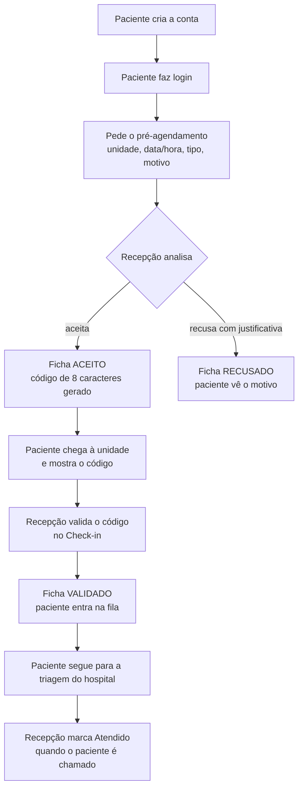
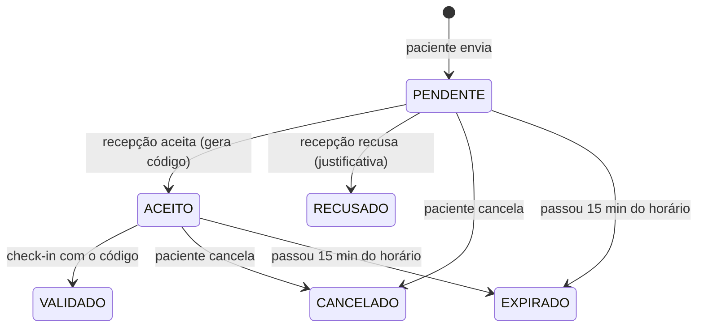
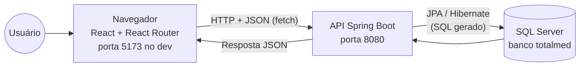
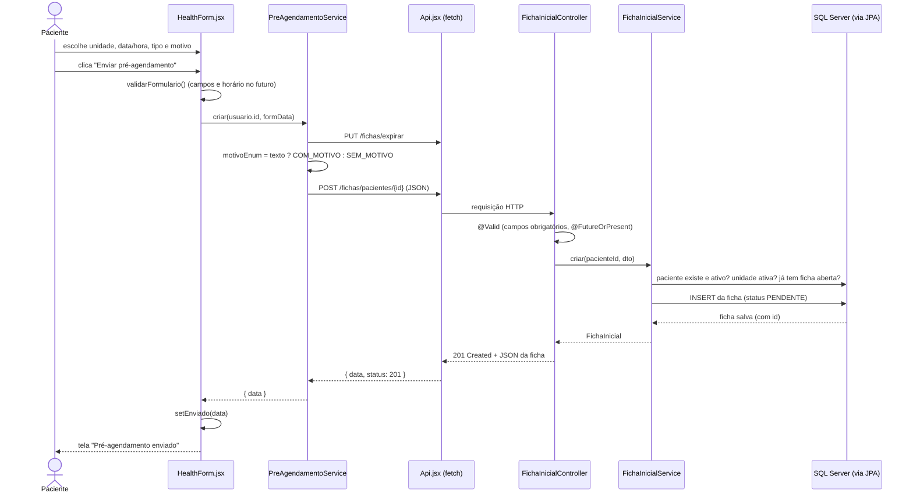
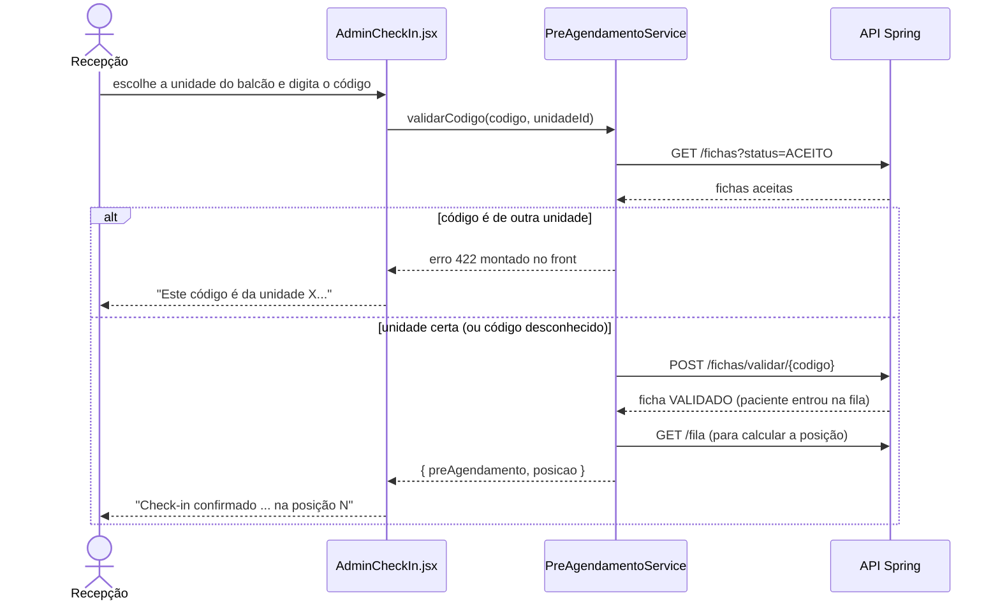

# GUIA_DE_ESTUDO_TCC_FRONTEND

# Guia de estudo do TCC — Frontend do TotalMed

> Material para estudar e explicar o projeto na banca. Escrito a partir do código atual do frontend (`frontend/totalmed`) e da API (`backend/totalmedRemake`), em 16/10/2026.
> 

## Como ler este guia

Os capítulos vão do geral para o detalhe. Se o tempo estiver curto, leia o **Capítulo 1**, o **Capítulo 12** (resumo) e as perguntas do **Capítulo 9**. Depois volte aos outros.

Ao longo do texto aparecem quatro marcas. Elas separam o que foi provado do que é opinião:

| Marca | Significado |
| --- | --- |
| ✅ **Testado** | Executado de verdade nesta revisão (lint, build, scripts ou teste clicando na interface). |
| 📖 **Lido no código** | Conclusão tirada da leitura do código, sem execução específica. |
| ⚠️ **Limitação** | Algo que não funciona, não existe ou não pôde ser testado. |
| 💡 **Recomendação** | Sugestão de melhoria que **não** foi implementada. |

**Como os testes desta revisão foram feitos.** Para não tocar no seu banco SQL Server, foi usada uma **cópia da API** rodando com banco H2 em memória (porta 8090). O frontend rodou com `npm run dev` apontando para essa cópia (`VITE_API_URL=http://localhost:8090`). Um robô (Firefox automatizado com a biblioteca `puppeteer-core`, instalada só numa pasta temporária, **fora** do projeto) clicou pelas telas como um usuário: criou contas, fez login, pediu pré-agendamento, aceitou, recusou, fez check-in, mexeu na fila e excluiu registros. O resultado final foi **34 de 34 passos aprovados**. Os detalhes estão no Capítulo 10.

## Sumário

1. [Visão geral do projeto](about:blank#cap%C3%ADtulo-1--vis%C3%A3o-geral-do-projeto)
2. [Tecnologias utilizadas](about:blank#cap%C3%ADtulo-2--tecnologias-utilizadas)
3. [Estrutura de pastas e arquivos](about:blank#cap%C3%ADtulo-3--estrutura-de-pastas-e-arquivos)
4. [Funcionamento do frontend por dentro](about:blank#cap%C3%ADtulo-4--funcionamento-do-frontend-por-dentro)
5. [Explicação de cada página e funcionalidade](about:blank#cap%C3%ADtulo-5--explica%C3%A7%C3%A3o-de-cada-p%C3%A1gina-e-funcionalidade)
6. [Integração entre frontend, API e banco de dados](about:blank#cap%C3%ADtulo-6--integra%C3%A7%C3%A3o-entre-frontend-api-e-banco-de-dados)
7. [Autenticação, permissões e segurança](about:blank#cap%C3%ADtulo-7--autentica%C3%A7%C3%A3o-permiss%C3%B5es-e-seguran%C3%A7a)
8. [Principais trechos de código explicados](about:blank#cap%C3%ADtulo-8--principais-trechos-de-c%C3%B3digo-explicados)
9. [Perguntas técnicas que podem aparecer na banca](about:blank#cap%C3%ADtulo-9--perguntas-t%C3%A9cnicas-que-podem-aparecer-na-banca)
10. [Problemas encontrados e melhorias](about:blank#cap%C3%ADtulo-10--problemas-encontrados-e-melhorias)
11. [Como demonstrar o projeto durante a apresentação](about:blank#cap%C3%ADtulo-11--como-demonstrar-o-projeto-durante-a-apresenta%C3%A7%C3%A3o)
12. [Resumo para revisão rápida](about:blank#cap%C3%ADtulo-12--resumo-para-revis%C3%A3o-r%C3%A1pida)

---

## Capítulo 1 — Visão geral do projeto

### 1.1 Qual é o objetivo do sistema?

O **TotalMed** é um sistema de **pré-agendamento digital** para unidades de saúde (clínicas e hospitais).

Em vez de chegar à unidade e enfrentar a fila da recepção para se identificar, o paciente faz um pedido pelo site **antes de sair de casa**. Ele escolhe:

- a **unidade** onde quer ser atendido;
- o **dia e a hora** em que pretende chegar;
- o **tipo de ficha**: Normal ou Preferencial;
- opcionalmente, o **motivo** do atendimento (ex.: “dor de cabeça há 3 dias”).

A recepção da unidade analisa o pedido. Se **aceitar**, o sistema gera um **código de 8 caracteres** (ex.: `E4EF-6556`). Quando o paciente chega, mostra o código no balcão, a recepção o **valida** e o paciente entra na **fila de triagem**, já ordenada por prioridade.

Um detalhe importante para não se confundir na banca: **o sistema não faz a triagem**. A triagem (avaliação de risco feita pela enfermagem) continua fora do sistema. O próprio backend diz isso no arquivo `backend/totalmedRemake/claude.md`: *“Não substitui a triagem da enfermeira.”* O TotalMed organiza **a chegada** do paciente.

### 1.2 Qual problema ele procura resolver?

Pelo texto da página inicial ([src/pages/Home.jsx](src/pages/Home.jsx)) e pelo fluxo implementado, o problema é a **burocracia e a espera na recepção**:

- o paciente perde tempo na fila só para se identificar;
- a recepção não sabe com antecedência quem vai chegar;
- quem tem direito a prioridade (idosos, gestantes, pessoas com deficiência) precisa ser identificado na hora.

Com o pré-agendamento, a recepção já tem os dados do paciente e o motivo antes da chegada. A fila de triagem é montada automaticamente na ordem de prioridade.

> 📖 O “problema” acima foi deduzido da Home e das regras do sistema. Se o seu grupo tem um texto oficial de justificativa (na monografia, por exemplo), use as palavras dele e trate este guia como apoio.
> 

### 1.3 Quem são os usuários?

O sistema tem **dois perfis ativos** (o campo `role` que a API devolve no login):

| Perfil | Quem é | Objetivo principal | Telas |
| --- | --- | --- | --- |
| `PACIENTE` | Pessoa que vai ser atendida | Pedir o pré-agendamento, acompanhar o status e pegar o código | Dashboard, Novo pré-agendamento, Meus pré-agendamentos, Minha conta |
| `ADMIN` | Equipe da recepção / administração da unidade | Analisar pedidos, fazer check-in, controlar a fila e manter o cadastro de unidades e administradores | Painel, Pré-agendamentos, Check-in, Fila de triagem, Clínicas e hospitais, Administradores |

Existe ainda `MEDICO` no enum `Role` da API, mas **sem uso**. As telas de médico do frontend foram desligadas quando a API deixou de ter médico, consulta e exame (os arquivos continuam no disco; veja o Capítulo 3).

### 1.4 Como o sistema funciona do início ao fim



Cada pedido (que a API chama de **ficha**, entidade `FichaInicial`) passa por estes **status**:



Na tela, `VALIDADO` aparece como **“Chegou”** (veja `STATUS_PRE_AGENDAMENTO` em [src/utils/preAgendamento.js](src/utils/preAgendamento.js#L7)).

### 1.5 Principais funcionalidades

**Público (sem login):** página inicial, login, criação de conta de paciente ou de administrador.

**Paciente:**

- painel com o status do pedido mais recente e o total de pedidos;
- novo pré-agendamento;
- lista de pedidos, com o código (se aceito), a justificativa (se recusado) e o botão de cancelar;
- ver e editar os próprios dados (nome, e-mail, telefone, altura, peso, convênio, endereço, senha);
- central de ajuda (perguntas frequentes);
- modo escuro.

**Administrador (recepção):**

- painel com indicadores, gráficos por status e por unidade, e a tabela de pacientes (com busca e exclusão);
- análise dos pré-agendamentos (filtros, aceitar, recusar com justificativa);
- check-in pelo código, conferindo a unidade do balcão;
- fila de triagem por unidade, na ordem de prioridade, com o botão “Atendido”;
- cadastro e exclusão de clínicas e hospitais;
- lista e exclusão de administradores.

### 1.6 Como frontend, backend e banco de dados se relacionam

Uma analogia ajuda: pense num restaurante.

- O **frontend** é o **salão**: o que o cliente vê e onde faz o pedido. É o código React que roda **no navegador** do usuário.
- O **backend** (a API) é a **cozinha**: recebe os pedidos, aplica as regras (“este prato acabou”, “você já pediu esse”) e prepara a resposta. É um programa Java com Spring Boot que roda num servidor (na sua máquina, porta 8080).
- O **banco de dados** é a **despensa**: onde os dados ficam guardados de forma permanente. É o SQL Server (banco `totalmed`).
- As **requisições HTTP** são o **garçom**: levam o pedido do salão para a cozinha e trazem a resposta. O formato das mensagens é **JSON** (texto estruturado, como `{"nome": "Maria"}`).



O frontend **nunca** fala direto com o banco. Tudo passa pela API, que decide o que pode e o que não pode. Por isso as **regras de negócio importantes ficam no backend**: uma ficha aberta por unidade, código gerado só no aceite, justificativa obrigatória na recusa, prazo de 15 minutos. O frontend mostra, valida o formato dos dados para ajudar o usuário e traduz os erros da API em mensagens legíveis.

---

## Capítulo 2 — Tecnologias utilizadas

As versões abaixo vêm do `package.json` e da instalação conferida com `npm ls` (✅). Node v24.14.0 e npm 11.19.1 estavam instalados na máquina da revisão.

> Sobre “por que escolheram”: o projeto **não tem um documento** registrando as decisões de tecnologia. As justificativas abaixo são as que **o código sustenta**. Se a banca perguntar o motivo da escolha, conte a história real do grupo e use estes argumentos como complemento técnico.
> 

### 2.1 Resumo

| Tecnologia | Versão | Papel no projeto |
| --- | --- | --- |
| React | 19.2.4 | Monta a interface em componentes e atualiza a tela quando os dados mudam |
| React DOM | 19.2.4 | Liga o React à página HTML (o `createRoot` do `main.jsx`) |
| React Router DOM | 7.18.4 | Navegação entre telas sem recarregar a página (rotas) |
| Vite | 8.0.0 | Servidor de desenvolvimento e gerador do build de produção |
| @vitejs/plugin-react | 6.0.1 | Ensina o Vite a entender JSX e recarregar componentes ao salvar |
| JavaScript (ES Modules) | — | Linguagem de todo o frontend (não há TypeScript) |
| `fetch` (API nativa do navegador) | — | Faz as requisições HTTP para a API (sem axios) |
| CSS com variáveis | — | Estilos, tema claro/escuro e layout responsivo (sem framework de CSS) |
| ESLint | 9.39.4 | Analisa o código e aponta erros e más práticas (`npm run lint`) |
| Google Fonts | — | Fontes Atkinson Hyperlegible e Bree Serif |
| localStorage | — | Guarda a sessão, o tema e a unidade do balcão no navegador |
| Node.js + `node:assert` | v24 | Executa as checagens `src/utils/*.check.js` |

Do lado da API (para contexto): Java 21, Spring Boot 4.0.6, Spring Data JPA/Hibernate, SQL Server, Bean Validation, Lombok e `spring-security-crypto` (só para o BCrypt das senhas).

### 2.2 React

- **O que é:** biblioteca JavaScript para construir interfaces a partir de **componentes**: funções que recebem dados e devolvem o que deve aparecer na tela.
- **Para que serve aqui:** todas as telas são componentes React (`src/pages/*.jsx`) montados com componentes menores (`src/components/*.jsx`).
- **Por que (evidência no código):** o projeto reaproveita muito. O mesmo `AdminLayout` envolve seis telas; o mesmo `PatientLayout` envolve quatro; o `GraficoFichas` aparece duas vezes no painel com dados diferentes. Além disso, as telas mudam o tempo todo com o **estado** (carregando, erro, lista vazia, modal aberto), e o React redesenha só o que mudou.
- **Onde aparece:** todos os `.jsx`; os hooks `useState`, `useEffect`, `useCallback` e `useRef`.
- **Sem ele:** seria preciso criar e alterar elementos HTML “na mão” (`document.createElement`, `innerHTML`…) a cada mudança de dado. Daria muito mais código e muito mais chance de a tela ficar dessincronizada dos dados.

### 2.3 React Router DOM

- **O que é:** biblioteca de **rotas** para React. Associa um endereço (ex.: `/admin/fila`) a um componente.
- **Para que serve aqui:** o TotalMed é uma **SPA** (*Single Page Application*): o navegador carrega um único `index.html` e o React troca o conteúdo conforme o endereço, sem recarregar a página.
- **Onde aparece:** [src/App.jsx](src/App.jsx) (tabela de rotas), `useNavigate` (ir para outra tela por código), `Link` (links), `Navigate` (redirecionar) e `useLocation` (ler o endereço atual e dados passados entre telas).
- **Sem ele:** cada tela seria um HTML separado, recarregando tudo a cada clique, ou seria preciso escrever um roteador próprio.

### 2.4 Vite e @vitejs/plugin-react

- **O que é:** ferramenta de build. No desenvolvimento (`npm run dev`) sobe um servidor em `http://localhost:5173` que atualiza a página ao salvar um arquivo. Em produção (`npm run build`) junta e comprime tudo na pasta `dist/`.
- **Para que serve aqui:** transforma JSX em JavaScript que o navegador entende, junta os imports, processa imagens e CSS e entrega as variáveis de ambiente `VITE_*` (`import.meta.env.VITE_API_URL` em [src/services/Api.jsx](src/services/Api.jsx#L10)).
- **Onde aparece:** [vite.config.js](vite.config.js), [index.html](index.html), scripts do [package.json](package.json).
- **Sem ele:** o navegador não entende JSX. Seria preciso outra ferramenta (Webpack, por exemplo) com mais configuração.

### 2.5 `fetch` em vez de axios

- **O que é:** função nativa do navegador para fazer requisições HTTP.
- **Por que (evidência):** o comentário no topo de [src/services/Api.jsx](src/services/Api.jsx) conta que o projeto usava **axios** e trocou por `fetch`, mantendo o mesmo formato de resposta (`{ data, status }`) e de erro (`erro.response`) para nenhum outro arquivo precisar mudar. Uma dependência a menos.
- **Sem ele (ou sem axios):** não haveria como conversar com a API.

### 2.6 CSS puro com variáveis (tema claro e escuro)

- **O que é:** CSS comum, um arquivo por tela em `src/styles/`, com **variáveis CSS** (*custom properties*, como `-accent`) definidas em [src/styles/tema.css](src/styles/tema.css).
- **Como funciona o tema:** `tema.css` define as cores em `:root` (tema claro) e redefine as mesmas variáveis em `:root.tema-escuro`. Trocar o tema é só colocar ou tirar a classe `tema-escuro` da tag `<html>`. Todas as telas usam `var(--accent)`, `var(--card-bg)` etc., então mudam juntas.
- **Responsividade:** há 25 regras `@media` nos estilos das telas ativas (ex.: `max-width: 680px`), mais `prefers-reduced-motion` para quem pede menos animação. ✅ A 390 px de largura (tamanho de celular), as telas testadas não têm rolagem horizontal.
- **Sem framework (Bootstrap, Tailwind):** menos dependências, controle total do visual. Em troca, há mais CSS escrito à mão (o `AdminDashboard.css` tem 830 linhas).

### 2.7 ESLint

- **O que é:** analisador de código. Procura erros comuns (variável não usada, regras dos hooks do React) sem executar o programa.
- **Onde:** [eslint.config.js](eslint.config.js), com os plugins `react-hooks` (regras dos hooks) e `react-refresh`.
- ✅ `npm run lint` (ou `npx eslint .`) terminou **sem nenhum aviso** antes e depois das correções.

### 2.8 Google Fonts e acessibilidade da fonte

O [index.html](index.html) carrega **Atkinson Hyperlegible** (texto) e **Bree Serif** (títulos).

> Conhecimento complementar: a Atkinson Hyperlegible foi criada pelo Braille Institute para facilitar a leitura por pessoas com baixa visão. É um bom argumento para um sistema de saúde, mas o código não registra que foi esse o motivo da escolha.
> 

### 2.9 localStorage

- **O que é:** um pequeno armazenamento de texto do navegador, separado por site, que continua lá depois de fechar a aba.
- **O que o projeto guarda nele:**
    - `usuario`: `{ id, nome, role }` devolvido pelo login (a sessão);
    - `temaEscuro`: `"true"` ou `"false"`;
    - `unidadeRecepcao`: id da unidade escolhida no balcão (check-in e fila).
- ⚠️ Não há senha nem token guardados. Isso é bom para a senha, mas significa que a “sessão” é só um texto que o próprio usuário consegue editar (Capítulo 7).

### 2.10 Ferramentas instaladas que hoje **não** são usadas

📖 Vale saber, porque alguém pode abrir o `package.json` na banca:

| Item | Situação |
| --- | --- |
| `babel-plugin-react-compiler`, `@rolldown/plugin-babel`, `@babel/core` | Instalados, mas o `vite.config.js` usa só `react()` sem Babel, então o **React Compiler não está ativo**. O `README.md` diz que está ligado porque é o texto padrão do modelo do Vite. |
| `json-server`, `concurrently`, `db.json`, scripts `server` e `dev:full` | Restos da fase em que o front usava uma API falsa (porta 3001). Hoje o front fala só com a API Spring. |
| `@types/react`, `@types/react-dom` | Só ajudam o editor a sugerir código; o projeto não usa TypeScript. |

---

## Capítulo 3 — Estrutura de pastas e arquivos

### 3.1 Visão geral

```
frontend/totalmed/
├── index.html              ← página única da SPA; carrega fontes, aplica o tema salvo e chama src/main.jsx
├── package.json            ← dependências e scripts (dev, build, lint, preview)
├── vite.config.js          ← configuração do Vite (plugin do React)
├── eslint.config.js        ← regras do ESLint
├── README.md               ← texto padrão do modelo React + Vite (não descreve o TotalMed)
├── db.json                 ← legado do json-server (não usado)
├── setup/                  ← scripts para preparar a máquina de desenvolvimento
├── dist/                   ← build de produção gerado por "npm run build" (fora do git)
├── node_modules/           ← dependências instaladas (fora do git)
└── src/
    ├── main.jsx            ← ponto de entrada: liga o React ao <div id="root">
    ├── App.jsx             ← tabela de rotas (endereço → tela)
    ├── assets/             ← imagens (logo, ícones dos cards de cadastro)
    ├── pages/              ← uma tela por arquivo (o que cada rota mostra)
    ├── components/         ← peças reutilizáveis (layouts, formulários de cadastro, ajuda, tema)
    │   └── admin/          ← peças do painel e da recepção (gráficos, tabela, modal, hook da unidade)
    ├── services/           ← conversa com a API (um arquivo por recurso)
    ├── utils/              ← funções puras: datas, máscaras, erros, sessão, tema, busca, regras de exibição
    └── styles/             ← CSS de cada tela + tema.css (cores e modo escuro)
```

A ideia da divisão: **`pages` decide o quê mostrar, `components` sabe como desenhar partes repetidas, `services` sabe como falar com a API, `utils` guarda regras pequenas e reutilizáveis.** Cada pasta tem uma responsabilidade, então é fácil achar onde mexer.

### 3.2 Arquivos de entrada e configuração

| Arquivo | Responsabilidade |
| --- | --- |
| [index.html](index.html) | Única página HTML. Tem o `<div id="root">`, onde o React desenha tudo, e um script curto que aplica o modo escuro **antes** da primeira pintura, para a tela não “piscar” branca. |
| [src/main.jsx](src/main.jsx) | Importa o `tema.css` global e monta o `<App />` dentro de `<React.StrictMode>`. |
| [src/App.jsx](src/App.jsx) | Declara todas as rotas. |
| [vite.config.js](vite.config.js) | Liga o plugin do React. Não tem mais proxy (veja o Capítulo 10, correção C1). |
| [eslint.config.js](eslint.config.js) | Regras de qualidade de código. |
| [package.json](package.json) | Scripts: `dev` (servidor de desenvolvimento), `build` (gera `dist/`), `lint`, `preview` (serve o `dist/`). |
| `setup/setup-dev.ps1` e `setup/iniciar-setup.bat` | Preparam um computador novo: `npm install`, extensões do VS Code e tema escuro do Windows. Não fazem parte do sistema. |
| `setup/comandos.txt` | Anotações de comandos (npm, SQL, git). |

### 3.3 Páginas (`src/pages/`) — uma por rota

| Arquivo | Rota | Perfil |
| --- | --- | --- |
| [Home.jsx](src/pages/Home.jsx) | `/` | público |
| [Login.jsx](src/pages/Login.jsx) | `/login` | público |
| [Register.jsx](src/pages/Register.jsx) | `/criar-conta` | público |
| [PatientDashboard.jsx](src/pages/PatientDashboard.jsx) | `/paciente/dashboard` | PACIENTE |
| [HealthForm.jsx](src/pages/HealthForm.jsx) | `/ficha-saude` (Novo pré-agendamento) | PACIENTE |
| [PatientRequests.jsx](src/pages/PatientRequests.jsx) | `/paciente/solicitacoes` | PACIENTE |
| [PatientAccount.jsx](src/pages/PatientAccount.jsx) | `/paciente/conta` | PACIENTE |
| [AdminDashboard.jsx](src/pages/AdminDashboard.jsx) | `/admin/dashboard` | ADMIN |
| [AdminPreAgendamentos.jsx](src/pages/AdminPreAgendamentos.jsx) | `/admin/pre-agendamentos` | ADMIN |
| [AdminCheckIn.jsx](src/pages/AdminCheckIn.jsx) | `/admin/check-in` | ADMIN |
| [AdminFilaTriagem.jsx](src/pages/AdminFilaTriagem.jsx) | `/admin/fila` | ADMIN |
| [AdminUnidades.jsx](src/pages/AdminUnidades.jsx) | `/admin/unidades` | ADMIN |
| [AdminAdministradores.jsx](src/pages/AdminAdministradores.jsx) | `/admin/administradores` | ADMIN |
| DoctorDashboard.jsx | **sem rota** (legado) | — |

O nome `HealthForm` (“ficha de saúde”) e a rota `/ficha-saude` vêm de uma versão anterior. Hoje a tela é o **formulário de pré-agendamento**.

### 3.4 Componentes (`src/components/`)

| Arquivo | O que faz | Usado em |
| --- | --- | --- |
| [PatientLayout.jsx](src/components/PatientLayout.jsx) | Moldura das telas do paciente: menu lateral, iniciais do nome, modo escuro, sair e o botão de ajuda. Recebe a tela pelo `children`. | 4 telas do paciente |
| [AdminLayout.jsx](src/components/AdminLayout.jsx) | Moldura das telas do admin: menu com grupos (Visão geral, Recepção, Gestão), rolagem até seções do painel, modo escuro e sair. | 6 telas do admin |
| [RegisterPatient.jsx](src/components/RegisterPatient.jsx) | Formulário de cadastro do paciente, com máscaras e validações. | `Register.jsx` |
| [RegisterAdmin.jsx](src/components/RegisterAdmin.jsx) | Formulário de cadastro do administrador. | `Register.jsx` |
| [CentralAjuda.jsx](src/components/CentralAjuda.jsx) | Botão flutuante “?” e janela de perguntas frequentes. Usa o `<dialog>` nativo do HTML. | `PatientLayout` |
| [BotaoTema.jsx](src/components/BotaoTema.jsx) | Botão de modo escuro das telas sem menu lateral (Home, Login, Criar conta). | Home, rotas de login e cadastro |
| [Logo.jsx](src/components/Logo.jsx) | Imagem do logo. | vários |
| DoctorLayout.jsx, RegisterDoctor.jsx | **Legado** (médico), sem uso. | — |

`src/components/admin/`:

| Arquivo | O que faz |
| --- | --- |
| [Indicadores.jsx](src/components/admin/Indicadores.jsx) | Os 4 cartões do painel: Pacientes, Pendentes, Aceitos, Recusados. |
| [GraficoFichas.jsx](src/components/admin/GraficoFichas.jsx) | Cartão com gráfico de barras e porcentagem; trata carregando, falha e vazio. |
| [BarrasHorizontais.jsx](src/components/admin/BarrasHorizontais.jsx) | As barras em si, desenhadas com HTML e CSS (sem biblioteca de gráficos). |
| [TabelaPacientes.jsx](src/components/admin/TabelaPacientes.jsx) | Tabela de pacientes com busca (nome, e-mail ou CPF) e botão Excluir. |
| [PreAgendamentoModal.jsx](src/components/admin/PreAgendamentoModal.jsx) | Janela de análise: dados do pedido, aceitar, recusar com justificativa, código gerado. |
| [useUnidadeRecepcao.js](src/components/admin/useUnidadeRecepcao.js) | Hook que carrega as unidades e lembra qual é a “unidade deste balcão”. |
| MedicoFormModal, TabelaMedicos, MedicosPorEspecialidade, ConsultasHoje, GraficoConsultas, statusConsulta.js | **Legado**, sem uso. |

### 3.5 Serviços (`src/services/`) — a ponte com a API

| Arquivo | Recurso da API | Usado hoje? |
| --- | --- | --- |
| [Api.jsx](src/services/Api.jsx) | Cliente HTTP genérico (`get`, `post`, `put`, `patch`, `delete`) | ✅ base de todos |
| [AuthService.js](src/services/AuthService.js) | `POST /login` | ✅ |
| [PacienteService.js](src/services/PacienteService.js) | `/pacientes` | ✅ (cadastrar, buscar, atualizar, deletar) |
| [AdminService.js](src/services/AdminService.js) | `/admin` | ✅ (cadastrar, listarAdmins, listarPacientes, gerarRelatorio, deletar); as funções de médico são legado |
| [PreAgendamentoService.js](src/services/PreAgendamentoService.js) | `/fichas` | ✅ |
| [FilaTriagemService.js](src/services/FilaTriagemService.js) | `/fila` | ✅ |
| [UnidadeService.js](src/services/UnidadeService.js) | `/clinicas` | ✅ |
| ConsultaService.js, ExameService.js, MedicoService.js, FilaService.js | Endpoints que **não existem mais** na API | ❌ legado |

O `Api.jsx` tem extensão `.jsx`, mas não contém JSX. Funciona igual; é só o nome.

### 3.6 Utilitários (`src/utils/`)

| Arquivo | Conteúdo |
| --- | --- |
| [sessao.js](src/utils/sessao.js) | `lerUsuario()` lê a sessão do localStorage; `useUsuario(role)` protege uma tela por perfil. |
| [erros.js](src/utils/erros.js) | `mensagemDeErro(erro, padrao)` transforma o erro da API numa frase para a tela. |
| [mascaras.js](src/utils/mascaras.js) | Máscaras de CPF, RG, CEP, data, telefone, altura e peso, e `aplicarMascara(campo, valor)`. |
| [datas.js](src/utils/datas.js) | Conversão e formatação de datas, `lerDataBR` e `idade` (usadas no cadastro). |
| [preAgendamento.js](src/utils/preAgendamento.js) | Rótulos de status e de tipo de ficha, formato do código e **ordem da fila**. |
| [busca.js](src/utils/busca.js) | Busca sem diferenciar maiúsculas nem acentos (“jose” encontra “José”). |
| [tema.js](src/utils/tema.js) | Hook `useTemaEscuro()`. |
| `*.check.js` (3 arquivos) | Checagens automáticas com `node:assert` (Capítulo 10). |

### 3.7 Estilos (`src/styles/`)

Um CSS por tela ou componente, importado no próprio `.jsx` (ex.: `import '../styles/Login.css'`), mais o [tema.css](src/styles/tema.css), importado uma vez no `main.jsx`. Como o CSS é **global** (não usa CSS Modules), cada área usa um **prefixo** nas classes para não colidir: `adm-` (painel admin), `rec-` (recepção), `ficha-` (pré-agendamento), `request-` (meus pedidos), `home-`, `ajuda-`.

`App.css`, `DoctorDashboard.css` e `DoctorLayout.css` não são importados por nenhuma tela ativa.

### 3.8 Por que há arquivos “legados” no projeto?

Em 07/10/2026 a API foi refeita para o fluxo de pré-agendamento e **perdeu** médico, consulta e exame. As telas e serviços de médico ficaram sem endpoint. Por decisão do grupo, os arquivos **continuam no disco**, mas foram desligados das rotas (`/medico/*` redireciona para `/login`, veja [src/App.jsx](src/App.jsx#L30)). Como nenhum arquivo ativo os importa, o Vite **não os coloca no build**. Se a banca perguntar, a resposta honesta é: “é código da versão anterior, guardado para referência; não roda no sistema atual”.

---

## Capítulo 4 — Funcionamento do frontend por dentro

Cada conceito abaixo tem: **o que é**, **um exemplo real**, **o que o código faz** e **o resultado para o usuário**.

### 4.1 Como a aplicação é inicializada

Quando alguém abre `http://localhost:5173/login`, acontece isto, nesta ordem:

1. O servidor (Vite no desenvolvimento) entrega **sempre o mesmo** [index.html](index.html), qualquer que seja o endereço. É assim que uma SPA funciona.
2. O `index.html` roda um script curto **antes** de desenhar qualquer coisa:
    
    ```html
    <script>
      document.documentElement.classList.toggle('tema-escuro', localStorage.getItem('temaEscuro') === 'true');
    </script>
    ```
    
    Se o usuário escolheu o modo escuro antes, a classe já entra na tag `<html>`. **Resultado:** a tela não pisca branca antes de ficar escura.
    
3. O navegador carrega [src/main.jsx](src/main.jsx):
    
    ```jsx
    import './styles/tema.css'
    import App from './App.jsx'
    
    ReactDOM.createRoot(document.getElementById('root')).render(
      <React.StrictMode>
        <App />
      </React.StrictMode>,
    )
    ```
    
    O `createRoot` pega o `<div id="root">` vazio do HTML e entrega ao React. A partir daí, tudo o que aparece na tela é o React que desenha.
    
4. O `<App />` lê o endereço (`/login`) e escolhe o componente da rota (`<Login />`).

**Sobre o `StrictMode`:** no modo de desenvolvimento, ele executa os efeitos (`useEffect`) **duas vezes** de propósito, para revelar bugs. ✅ Nos testes, por isso, a API recebeu algumas requisições em dobro (ex.: dois “Paciente não encontrado” no log). No build de produção isso não acontece.

### 4.2 Componentes, props e `children`

Um **componente** é uma função que devolve **JSX**: um jeito de escrever HTML dentro do JavaScript.

**Props** são os “parâmetros” do componente. Exemplo real, [src/components/BotaoTema.jsx](src/components/BotaoTema.jsx#L10):

```jsx
export default function BotaoTema({ fixo = false }) {
  const [escuro, alternarTema] = useTemaEscuro();
  return (
    <button className={`botao-tema${fixo ? 'botao-tema-fixo' : ''}`} onClick={alternarTema} ...>
```

Em [src/App.jsx](src/App.jsx) ele é usado como `<BotaoTema fixo />` (botão preso no canto, nas telas de login e cadastro) e, na Home, como `<BotaoTema />` (dentro do cabeçalho). **Um componente, dois comportamentos**, controlados por uma prop.

**`children`** é a prop especial com “o que vai dentro”. Os layouts usam isso:

```jsx
// src/components/PatientLayout.jsx
export default function PatientLayout({ children }) {
  ...
  return (
    <div className="patient-shell">
      <aside className="patient-sidebar">...menu...</aside>
      <main className="patient-main">{children}</main>
      <CentralAjuda />
    </div>
  );
}
```

E cada tela do paciente se “embrulha” nele: `<PatientLayout> ...conteúdo da tela... </PatientLayout>`. **Resultado:** o menu, o botão de sair e a ajuda são escritos **uma vez só** e aparecem nas quatro telas.

### 4.3 Como as páginas são renderizadas (JSX, condições e listas)

Três padrões aparecem em quase toda tela:

**a) Mostrar algo só se uma condição for verdadeira** (`&&`):

```jsx
{erros.geral &&<div className="erro-geral">{erros.geral}</div>}
```

Se `erros.geral` está vazio, nada aparece; se tem texto, aparece a caixa vermelha.

**b) Escolher entre duas ou mais telas** (operador ternário `? :`), de [src/pages/PatientRequests.jsx](src/pages/PatientRequests.jsx):

```jsx
{carregando ? (
  <p className="requests-empty">Carregando...</p>
) : itens.length === 0 ? (
  ...cartão "Você ainda não fez nenhum pré-agendamento"...
) : (
  <div className="requests-list"> ...um cartão por pedido... </div>
)}
```

É assim que o projeto trata os **estados de carregamento, vazio e com dados**.

**c) Listas com `map` e `key`:**

```jsx
{itens.map((item) => (
  <article className="request-card" key={item.id}> ... </article>
))}
```

O `map` transforma cada pedido num cartão. A `key` (o id do pedido) ajuda o React a saber qual cartão é qual quando a lista muda. Por exemplo, ao cancelar um pedido, só aquele cartão é redesenhado.

### 4.4 Navegação entre rotas

As rotas ficam em [src/App.jsx](src/App.jsx):

```jsx
<Router>
  <Routes>
    <Route path="/login" element={<><BotaoTema fixo /><Login /></>} />
    <Route path="/paciente/dashboard" element={<PatientDashboard />} />
    <Route path="/admin/dashboard" element={<AdminDashboard />} />
    <Route path="/medico/*" element={<Navigate to="/login" replace />} />
    <Route path="/" element={<Home />} />
    <Route path="*" element={<Navigate to="/" replace />} />
    ...
  </Routes>
</Router>
```

O projeto navega de quatro formas:

| Forma | Exemplo | Quando |
| --- | --- | --- |
| `<Link to="...">` | `<Link to="/login">Entrar</Link>` na Home | Link clicável comum |
| `navigate('...')` | `navigate(rotas[data.role] \|\| '/')` no Login | Ir para outra tela **depois** de uma ação (login deu certo) |
| `<Navigate to="..." replace />` | `/medico/*` → `/login` | Redirecionar automaticamente |
| `navigate(rota, { state })` | `navigate('/login', { state: { mensagem: 'Conta criada!...' } })` | Levar um dado junto para a próxima tela |

O `replace` troca a entrada no histórico do navegador, então o botão “Voltar” não cai de novo no endereço que redirecionou.

O último exemplo é usado em dois lugares:

- o **cadastro** manda a mensagem “Conta criada!” para o **login**, que a lê com `useLocation().state?.mensagem` ([src/pages/Login.jsx](src/pages/Login.jsx#L17));
- o **menu do admin**, fora do painel, manda `{ secao: 'pacientes' }` para o painel rolar até a tabela de pacientes (`irParaSecao` em [src/components/AdminLayout.jsx](src/components/AdminLayout.jsx#L138)).

### 4.5 Estado: como os dados são guardados e atualizados

**Estado** é a “memória” de um componente: valores que, quando mudam, fazem a tela ser redesenhada. Cria-se com `useState`:

```jsx
// src/pages/Login.jsx
const [formData, setFormData] = useState({ email: '', password: '' });
const [erros, setErros] = useState({});
const [carregando, setCarregando] = useState(false);
```

- `formData` guarda o que foi digitado;
- `erros` guarda as mensagens de erro de cada campo;
- `carregando` liga o “Entrando…” e desabilita o botão.

**Regra de ouro:** nunca altere o estado diretamente (`formData.email = 'x'` não redesenha nada). Sempre chame a função `set...` com um **objeto novo**:

```jsx
setFormData(prev => ({ ...prev, [name]: value }));
```

`...prev` copia todos os campos antigos e `[name]: value` troca só o campo que mudou (o `name` do input, como `email`). Usar `prev =>` garante que se parte do valor mais atual.

**Dados derivados não viram estado.** Em vez de guardar “a lista filtrada” num estado separado, o projeto calcula na hora de desenhar. Exemplo em [src/pages/AdminPreAgendamentos.jsx](src/pages/AdminPreAgendamentos.jsx#L88):

```jsx
const visiveis = itens
  .filter((item) =>
    (!filtros.status || item.status === filtros.status) &&
    (!filtros.unidadeId || String(item.clinica?.id) === filtros.unidadeId) &&
    (!filtros.data || item.dataPreferencial.startsWith(filtros.data)))
  .sort(porDataEPedido);
```

**Resultado:** ao trocar um filtro, a tabela atualiza na hora, sem nova chamada à API e sem risco de a lista filtrada ficar diferente da original.

**Não há estado global** (Redux, Context API). Cada tela busca o que precisa. O que é compartilhado entre telas vai para o `localStorage` (sessão, tema, unidade do balcão).

### 4.6 Efeitos: buscar dados ao abrir a tela

`useEffect` roda código **depois** que o componente aparece na tela. É onde o projeto busca dados na API. Exemplo em [src/pages/PatientDashboard.jsx](src/pages/PatientDashboard.jsx#L61):

```jsx
useEffect(() => {
  if (!usuario) return;

  preAgendamentoService.listarPorPaciente(usuario.id)
    .then(({ data }) => {
      setTotalPedidos(data.length);
      setStatus(STATUS_LABELS[data[0]?.status] || STATUS_LABELS.SEM_PEDIDO);
    })
    .catch((e) => {
      console.error('Erro ao carregar dashboard do paciente:', e);
      setErro(mensagemDeErro(e, 'Não foi possível carregar seus dados agora.'));
    })
    .finally(() => setCarregando(false));
}, [usuario]);
```

- O `[usuario]` no fim é a **lista de dependências**: o efeito roda quando a tela abre e de novo só se `usuario` mudar.
- `.then` trata o sucesso, `.catch` o erro e `.finally` roda nos dois casos (desliga o “carregando”).

**Efeito com limpeza.** Quando o efeito cria algo que precisa ser desfeito, ele devolve uma função de limpeza. O aviso de sucesso do painel some sozinho em 5 segundos ([src/pages/AdminDashboard.jsx](src/pages/AdminDashboard.jsx)):

```jsx
useEffect(() => {
  if (aviso?.tipo !== 'sucesso') return undefined;
  const timer = setTimeout(() => setAviso(null), 5000);
  return () => clearTimeout(timer);   // se o aviso mudar antes, cancela o timer antigo
}, [aviso]);
```

O modal de pré-agendamento faz o mesmo com a tecla Esc: adiciona um `keydown` ao abrir e remove ao fechar ([src/components/admin/PreAgendamentoModal.jsx](src/components/admin/PreAgendamentoModal.jsx#L19)).

### 4.7 Hooks: os do React e os do projeto

**Hook** é uma função especial do React que começa com `use` e só pode ser chamada no topo do componente.

| Hook | Para que | Exemplo no projeto |
| --- | --- | --- |
| `useState` | Guardar estado | Todos os formulários |
| `useEffect` | Rodar algo depois de desenhar (buscar dados, timers) | Todas as telas que carregam dados |
| `useCallback` | Manter a **mesma** função entre desenhos, para poder usá-la como dependência de um efeito | `carregar` em `AdminPreAgendamentos`, `carregarTudo` em `AdminDashboard` |
| `useRef` | Guardar uma referência a um elemento da tela | `dialogo` em `CentralAjuda` (abre o `<dialog>`), `campoCodigo` no Check-in (devolve o foco ao campo) |
| `useNavigate`, `useLocation` | Navegar e ler o endereço (React Router) | Login, layouts |

O projeto também cria **hooks próprios**. Eles juntam lógica repetida num lugar só:

| Hook | Arquivo | O que faz |
| --- | --- | --- |
| `useUsuario(role)` | [src/utils/sessao.js](src/utils/sessao.js#L14) | Lê a sessão; se não há usuário ou o perfil é outro, manda para `/login` |
| `useTemaEscuro()` | [src/utils/tema.js](src/utils/tema.js#L9) | Guarda a preferência de tema e aplica a classe `tema-escuro` |
| `useUnidadeRecepcao()` | [src/components/admin/useUnidadeRecepcao.js](src/components/admin/useUnidadeRecepcao.js#L9) | Carrega as unidades e lembra a unidade do balcão (Check-in e Fila usam o mesmo) |

### 4.8 Eventos

Eventos são ações do usuário que o código “escuta”:

| Evento | Exemplo | O que acontece |
| --- | --- | --- |
| `onChange` | todos os inputs | Atualiza o estado a cada tecla |
| `onSubmit` | `<form onSubmit={handleSubmit}>` | Envia o formulário (Enter ou botão `type="submit"`) |
| `onClick` | botões | Ações como Aceitar, Excluir, Sair |
| `onMouseDown` no fundo do modal | `PreAgendamentoModal`, `CentralAjuda` | Clicar fora da janela fecha a janela |

Todo `handleSubmit` começa com `e.preventDefault()`. Sem isso, o navegador recarregaria a página ao enviar o formulário (comportamento padrão do HTML) e o React perderia tudo.

### 4.9 Formulários: capturar e validar

Os formulários são **controlados**: o valor de cada input vem do estado (`value={formData.email}`) e cada tecla passa pelo `onChange`. Isso permite **máscaras** e **validações** antes de enviar.

**Máscaras.** Em [src/components/RegisterPatient.jsx](src/components/RegisterPatient.jsx#L25):

```jsx
const handleChange = (e) => {
  const { name, value } = e.target;
  setFormData(prev => ({ ...prev, [name]: aplicarMascara(name, value) }));
  if (erros[name]) setErros(prev => ({ ...prev, [name]: '' }));
};
```

`aplicarMascara` ([src/utils/mascaras.js](src/utils/mascaras.js#L111)) procura uma máscara pelo **nome do campo**: `cpf` → `000.000.000-00`, `tell` → `(11) 99999-9999`, `cep` → `00000-000`, `altura` → `1,70` etc. Campos sem máscara (nome, e-mail) passam sem mudança. A segunda linha apaga a mensagem de erro do campo assim que o usuário volta a digitar nele.

**Validação.** Cada formulário tem uma função que monta um objeto de erros e devolve `true` se ele ficou vazio:

```jsx
const validarFormulario = () => {
  const e = {};
  if (!validarCPF(formData.cpf)) e.cpf = 'CPF inválido';
  ...
  setErros(e);
  return Object.keys(e).length === 0;
};
```

E cada campo mostra o seu erro logo abaixo:

```jsx
<input name="cpf" ... className={erros.cpf ? 'input-erro' : ''} />
{erros.cpf &&<span className="erro-texto">{erros.cpf}</span>}
```

Alguns formulários usam `noValidate` na tag `<form>` (pré-agendamento, unidades, check-in) para desligar os balões de validação do navegador e mostrar só as mensagens do próprio sistema, todas em português e no mesmo estilo.

### 4.10 Mensagens de erro e de sucesso

O projeto usa três tipos de mensagem:

1. **Erro de campo:** texto vermelho abaixo do input (`erro-texto`, `adm-campo-erro`, `ficha-erro-texto`).
2. **Erro geral:** caixa no topo do formulário, com a frase vinda da API (`erros.geral`), traduzida por `mensagemDeErro` ([src/utils/erros.js](src/utils/erros.js)).
3. **Aviso de sucesso:** caixa verde (“O paciente X foi excluído.”, “Conta criada!…”). Nas telas do admin some em 5 segundos.

Para leitores de tela (acessibilidade), as caixas usam `role="alert"` (erro, é anunciado na hora) ou `role="status"` (sucesso, é anunciado sem interromper).

### 4.11 Estilos e layout

- **Cores e tema:** só em [src/styles/tema.css](src/styles/tema.css), como variáveis. Exemplo: `-accent: #1f8a4c` no claro e `-accent: #34c471` no escuro. O comentário do arquivo explica um cuidado de contraste: o botão usa o verde escuro no tema claro porque branco sobre o verde claro não chega à proporção 4.5:1 recomendada para leitura.
- **Layout das áreas logadas:** menu lateral fixo + área principal (`patient-shell`, `admin-shell`), com CSS Grid e Flexbox. Em telas estreitas, o menu passa para cima do conteúdo.
- **Gráficos:** as barras do painel são `<div>`s com `width` em porcentagem ([src/components/admin/BarrasHorizontais.jsx](src/components/admin/BarrasHorizontais.jsx)). Cada linha mostra o número em texto, então o gráfico não depende de passar o mouse.
- **Movimento reduzido:** regras `@media (prefers-reduced-motion: reduce)` desligam animações para quem configurou isso no sistema operacional. O `rolarPara` do `AdminLayout` também troca a rolagem suave pela imediata nesse caso.

---

## Capítulo 5 — Explicação de cada página e funcionalidade

### 5.1 Inventário de rotas

| Rota | Tela | Quem acessa | O que acontece se não puder |
| --- | --- | --- | --- |
| `/` | Home | todos | — |
| `/login` | Login | todos | — |
| `/criar-conta` | Criar conta (escolha do tipo + formulário) | todos | — |
| `/paciente/dashboard` | Painel do paciente | PACIENTE | vai para `/login` |
| `/ficha-saude` | Novo pré-agendamento | PACIENTE | vai para `/login` |
| `/paciente/solicitacoes` | Meus pré-agendamentos | PACIENTE | vai para `/login` |
| `/paciente/conta` | Minha conta | PACIENTE | vai para `/login` |
| `/admin` | — | — | redireciona para `/admin/dashboard` |
| `/admin/dashboard` | Painel do administrador | ADMIN | vai para `/login` |
| `/admin/pre-agendamentos` | Análise dos pedidos | ADMIN | vai para `/login` |
| `/admin/check-in` | Check-in | ADMIN | vai para `/login` |
| `/admin/fila` | Fila de triagem | ADMIN | vai para `/login` |
| `/admin/unidades` | Clínicas e hospitais | ADMIN | vai para `/login` |
| `/admin/administradores` | Administradores | ADMIN | vai para `/login` |
| `/medico/*` | — | — | redireciona para `/login` (médico saiu da API) |
| `/cadastro-concluido`, `/esqueci-senha` | — | — | redirecionam para `/login` |
| qualquer outro endereço | — | — | redireciona para `/` |

⚠️ `/esqueci-senha` **não tem tela**: não existe recuperação de senha no sistema.

Os principais fluxos ponta a ponta estão nos Capítulos 1.4 (visão geral) e 6.7 (caminho técnico).

### 5.2 Home — `/`

1. **Finalidade:** apresentar o TotalMed e levar ao cadastro ou ao login.
2. **Como chegar:** abrir o site; o link “← Início” do login e do cadastro também volta para cá.
3. **Arquivos:** [src/pages/Home.jsx](src/pages/Home.jsx), [src/styles/Home.css](src/styles/Home.css), `BotaoTema`.
4. **Dados:** só texto fixo. A lista “Como funciona” é um array `passos` desenhado com `map`. O “ticket” é um **exemplo ilustrativo** (paciente e código fictícios).
5. **Ações:** Entrar, Criar conta, “Ver como funciona” (âncora `#como-funciona`), modo escuro.
6. **API:** nenhuma.
7. **Regras:** nenhuma.
8. **Erros:** não há chamadas, então não há erro de rede.
9. **Como verificar:** ✅ testado: o título aparece e “Entrar” leva ao `/login`.

### 5.3 Login — `/login`

1. **Finalidade:** identificar o usuário e mandar cada perfil para o seu painel.
2. **Como chegar:** “Entrar” na Home ou qualquer redirecionamento de tela protegida.
3. **Arquivos:** [src/pages/Login.jsx](src/pages/Login.jsx), [src/services/AuthService.js](src/services/AuthService.js), [src/styles/Login.css](src/styles/Login.css).
4. **Dados:** e-mail e senha digitados. A resposta da API é `{ id, nome, role }`, gravada no localStorage como `usuario`.
5. **Ações:** entrar, ir para “Criar conta”, voltar ao início.
6. **API:** `POST /login` com `{ email, password }`.
7. **Validações:** e-mail obrigatório e com formato válido; senha obrigatória com pelo menos 6 caracteres.
8. **Erros:** 401 → “Email ou senha incorretos”; qualquer outro erro → “Erro ao conectar ao servidor”. Depois de criar conta, aparece a caixa verde “Conta criada! Entre com seu e-mail e senha.”
9. **Como verificar:** ✅ testado: campos vazios mostram os erros, senha errada mostra a mensagem do 401, paciente vai para `/paciente/dashboard` e admin para `/admin/dashboard`, e com a API desligada aparece “Erro ao conectar ao servidor”.

### 5.4 Criar conta — `/criar-conta`

1. **Finalidade:** criar uma conta de **paciente** ou de **administrador**.
2. **Como chegar:** “Criar conta” na Home ou no Login.
3. **Arquivos:** [src/pages/Register.jsx](src/pages/Register.jsx) (escolha do tipo), [src/components/RegisterPatient.jsx](src/components/RegisterPatient.jsx), [src/components/RegisterAdmin.jsx](src/components/RegisterAdmin.jsx), `PacienteService`, `AdminService`, `mascaras.js`, `datas.js`, `erros.js`.
4. **Dados:** o `Register` guarda `tipoSelecionado` (`null`, `'paciente'` ou `'admin'`) e mostra o formulário correspondente. Não muda de rota: é **renderização condicional**.
5. **Ações:** escolher o tipo, preencher, enviar, “← Voltar” para a escolha.
6. **API:** paciente → `POST /pacientes`; administrador → `POST /admin`. O formulário converte os dados para o formato da API antes de enviar: data `dd/mm/aaaa` → `aaaa-mm-dd`, CPF só com dígitos, sexo em maiúsculas (`FEMININO`), altura `1,65` → `1.65`, endereço como objeto.
7. **Validações (no front):** nome com pelo menos duas palavras; CPF com dígitos verificadores válidos; RG com 8 dígitos; telefone com 10 ou 11 dígitos; data de nascimento **real** e idade mínima de **18 anos** (contando mês e dia); e-mail válido; senha com 8+ caracteres, maiúscula, minúscula e número; confirmação igual. No paciente também: sexo, altura (0,1 a 3 m), peso (0,1 a 500 kg) e endereço. **Na API:** campos obrigatórios (`@NotBlank`, `@NotNull`), e-mail com formato válido, faixas de altura e peso, e **e-mail, CPF e RG únicos** entre todos os usuários.
8. **Erros:** os da API aparecem no topo (ex.: ✅ “E-mail já cadastrado”, vindo do 409). Sucesso → vai para o login com a mensagem verde.
9. **Como verificar:** ✅ testado: formulário vazio mostra os erros; as máscaras formatam CPF, telefone, altura e CEP; 31/02/2000 é recusado como “Data inválida”; quem faz 18 anos só em dezembro é barrado; cadastro válido vai ao login; e-mail repetido mostra o 409.

⚠️ O cadastro de administrador pede “Sexo”, mas a API **não guarda** esse dado para administradores (o `PostAdminDTO` não tem o campo). Veja o Capítulo 10.

### 5.5 Painel do paciente — `/paciente/dashboard`

1. **Finalidade:** resumo rápido: status do pedido mais recente e total de pedidos.
2. **Como chegar:** login de paciente ou “Dashboard” no menu.
3. **Arquivos:** [src/pages/PatientDashboard.jsx](src/pages/PatientDashboard.jsx), `PatientLayout`, `PreAgendamentoService`.
4. **Dados:** a lista de pedidos do paciente, já ordenada do mais recente para o mais antigo. O status do primeiro vira um título e uma descrição (tabela `STATUS_LABELS`, ex.: `VALIDADO` → “Na fila de triagem”).
5. **Ações:** “Novo Pré-agendamento” e “Ver Meus Pré-agendamentos”.
6. **API:** `PUT /fichas/expirar` (atualiza as vencidas) e `GET /fichas/pacientes/{id}`.
7. **Regras:** sem pedidos, mostra “Nenhum pedido”.
8. **Erros:** mensagem vermelha no topo; os números ficam “—”.
9. **Como verificar:** ✅ testado: paciente novo vê “Nenhum pedido”.

### 5.6 Novo pré-agendamento — `/ficha-saude`

1. **Finalidade:** o paciente pede atendimento numa unidade, num dia e numa hora.
2. **Como chegar:** menu “Novo Pré-agendamento” ou botão no painel.
3. **Arquivos:** [src/pages/HealthForm.jsx](src/pages/HealthForm.jsx), `UnidadeService`, `PacienteService`, `PreAgendamentoService`, [src/utils/preAgendamento.js](src/utils/preAgendamento.js) (`TIPOS_FICHA`), [src/utils/datas.js](src/utils/datas.js) (`dataHoraISO`).
4. **Dados:** ao abrir, carrega as **unidades ativas** (`GET /clinicas`, filtradas por `ativa`) e o cadastro do paciente (`GET /pacientes/{id}`) para mostrar nome, CPF e convênio em “Seus dados”.
5. **Ações:** escolher a unidade, a data e hora (`<input type="datetime-local">`), o tipo de ficha e escrever o motivo (opcional). Ao escolher Preferencial, aparece um aviso com quem tem direito.
6. **API:** `PUT /fichas/expirar` e depois `POST /fichas/pacientes/{pacienteId}` com `{ unidadeId, dataPreferencial, tipoFichaAtendimento, motivoEnum, motivoString }`. O `motivoEnum` é decidido pelo serviço: com texto → `COM_MOTIVO`; sem texto → `SEM_MOTIVO` (Capítulo 8.8).
7. **Regras:**
    - **front:** unidade, data/hora e tipo obrigatórios; o horário precisa estar **no futuro** (o minuto atual é recusado);
    - **API:** unidade existente e ativa, paciente ativo, data presente ou futura (`@FutureOrPresent`), **no máximo uma ficha PENDENTE ou ACEITO por paciente em cada unidade**, e o motivo coerente com o `motivoEnum`.
8. **Erros:** os da API aparecem no topo. ✅ Exemplo testado: o segundo pedido aberto na mesma unidade mostra “Você já tem uma ficha em andamento nesta unidade” (422). Se as unidades não carregarem, aparece “As unidades não carregaram. Recarregue a página.”
9. **Como verificar:** ✅ testado: campos vazios mostram os erros; pedido válido mostra “Pré-agendamento enviado”; a regra de uma ficha por unidade funciona; o minuto atual é barrado com “Escolha um horário no futuro”.

### 5.7 Meus pré-agendamentos — `/paciente/solicitacoes`

1. **Finalidade:** acompanhar cada pedido: status, código, motivo da recusa; cancelar.
2. **Como chegar:** menu, painel ou “Acompanhar pedido” depois de enviar.
3. **Arquivos:** [src/pages/PatientRequests.jsx](src/pages/PatientRequests.jsx) (com o componente interno `Situacao`), `PreAgendamentoService`, `preAgendamento.js` (`lerStatus`, `lerTipoFicha`, `formatarCodigo`).
4. **Dados:** a lista do paciente. Para cada status, o `Situacao` mostra uma informação diferente: código em destaque (ACEITO), justificativa (RECUSADO), “Check-in feito” (VALIDADO), “expirou” (EXPIRADO) e assim por diante.
5. **Ações:** “Cancelar pedido”, disponível só para PENDENTE e ACEITO (`CANCELAVEIS`), com confirmação.
6. **API:** `GET /fichas/pacientes/{id}`; cancelar → `PUT /fichas/{id}/cancelar`. A resposta (a ficha já cancelada) substitui o item na lista, sem recarregar tudo.
7. **Regras:** a API só cancela PENDENTE ou ACEITO (“Só é possível cancelar ficha pendente ou aceita”).
8. **Erros:** mensagem no topo; durante o cancelamento o botão mostra “Cancelando…” e fica desabilitado.
9. **Como verificar:** ✅ testado: os dois pedidos aparecem como Pendente; depois das ações da recepção, aparecem “Chegou” e a justificativa da recusa. 📖 O botão de cancelar foi lido no código, mas não clicado nos testes.

### 5.8 Minha conta — `/paciente/conta`

1. **Finalidade:** ver e corrigir os próprios dados.
2. **Como chegar:** menu “Minha Conta”.
3. **Arquivos:** [src/pages/PatientAccount.jsx](src/pages/PatientAccount.jsx), `PacienteService`, `mascaras.js`.
4. **Dados:** `GET /pacientes/{id}`. Mostra tudo; no modo de edição, CPF, RG, data de nascimento e sexo ficam **bloqueados**.
5. **Ações:** Editar, Salvar, Cancelar, “Alterar senha” (abre os campos de nova senha).
6. **API:** `PATCH /pacientes/{id}` (atualização **parcial**) só com os campos que o PATCH aceita. Data de nascimento e sexo ficam de fora porque a API só os troca no `PUT`, que exige reenviar a senha.
7. **Regras:** nome obrigatório, e-mail válido, telefone com 10 ou 11 dígitos (com máscara), altura e peso nas faixas da API, nova senha forte e confirmada. Convênio vazio **não é enviado**, porque a API recusa texto vazio no PATCH.
8. **Erros:** caixa no topo do formulário. Depois de salvar, o nome e o e-mail também são atualizados no localStorage, para o menu mostrar o nome novo.
9. **Como verificar:** ✅ testado: digitar “abc” no telefone é bloqueado pela máscara e o salvamento é barrado; salvar com dados válidos mostra “Informações atualizadas com sucesso.” e o peso novo.

### 5.9 Central de ajuda (componente, telas do paciente)

1. **Finalidade:** perguntas frequentes sobre o fluxo.
2. **Como chegar:** botão redondo “?” no canto das telas do paciente.
3. **Arquivo:** [src/components/CentralAjuda.jsx](src/components/CentralAjuda.jsx).
4. **Dados:** array fixo `PERGUNTAS`.
5. **Ações:** abrir, expandir uma pergunta, fechar (×, Esc ou clique fora).
6. **API:** nenhuma.
7. **Detalhe técnico interessante:** usa só HTML nativo. O `<dialog>` com `showModal()` já prende o foco, fecha com Esc e devolve o foco ao botão; vários `<details name="ajuda-faq">` com o mesmo `name` fazem o navegador manter só uma resposta aberta. Nenhuma biblioteca foi necessária.
8. **Como verificar:** 📖 lido no código; não foi clicado nos testes automáticos.

### 5.10 Painel do administrador — `/admin/dashboard`

1. **Finalidade:** visão geral: indicadores, gráficos e gestão de pacientes.
2. **Como chegar:** login de administrador; “Visão geral” ou “Pacientes” no menu.
3. **Arquivos:** [src/pages/AdminDashboard.jsx](src/pages/AdminDashboard.jsx), `Indicadores`, `GraficoFichas`, `BarrasHorizontais`, `TabelaPacientes`, `AdminService`, `PreAgendamentoService`, `PacienteService`.
4. **Dados:** três chamadas: `GET /fichas` (todos os pedidos), `GET /admin/relatorio` (contagens prontas) e `GET /admin/pacientes`. Com a lista de pedidos, a tela **calcula**: pedidos por status, por unidade, por paciente e quantos ACEITOS são para hoje.
5. **Ações:** Atualizar; buscar paciente por nome, e-mail ou CPF (sem acento e sem diferenciar maiúsculas); excluir paciente (com confirmação que avisa quantos pedidos serão apagados juntos).
6. **API:** as três acima e `DELETE /pacientes/{id}`.
7. **Regras:** a exclusão é **definitiva**: a API apaga junto os pedidos e as entradas na fila do paciente.
8. **Erros:** cada bloco falha sozinho. Se o relatório não vier, os cartões mostram “—” e um aviso; se a lista de pedidos falhar, os gráficos dizem “Os pré-agendamentos não carregaram.” (veja `Promise.allSettled` no Capítulo 8.14). Paciente já removido (404) gera um aviso específico.
9. **Como verificar:** ✅ testado: o indicador “Pendentes” bate com a contagem da API; busca por “jose” encontra “José”; a exclusão mostra “foi excluído”; com a API fora do ar, aparecem os avisos “Os indicadores não carregaram…” e “A lista de pacientes não carregou.”

### 5.11 Pré-agendamentos (recepção) — `/admin/pre-agendamentos`

1. **Finalidade:** analisar os pedidos: aceitar (gera código) ou recusar (com justificativa).
2. **Como chegar:** menu “Pré-agendamentos”.
3. **Arquivos:** [src/pages/AdminPreAgendamentos.jsx](src/pages/AdminPreAgendamentos.jsx), [src/components/admin/PreAgendamentoModal.jsx](src/components/admin/PreAgendamentoModal.jsx), `PreAgendamentoService`, `UnidadeService`.
4. **Dados:** todos os pedidos e todas as unidades. A tela abre filtrada em **Pendente** (“caixa de entrada”) e ordena pelo horário mais próximo.
5. **Ações:** filtrar por status, unidade e data; “Analisar” (pendente) ou “Detalhes” (outros); no modal: “Aceitar e gerar código”, “Recusar” → escrever a justificativa → “Confirmar recusa”.
6. **API:** `GET /fichas`, `GET /clinicas`, `PUT /fichas/{id}/aceitar`, `PUT /fichas/{id}/recusar` com `{ justificativa }`.
7. **Regras:** na API, só ficha PENDENTE pode ser aceita ou recusada, ficha vencida não pode ser aceita, e a justificativa é obrigatória (`@NotBlank`). No front, a justificativa vazia é barrada antes de chamar a API. Depois de aceitar, o modal **continua aberto** mostrando o código.
8. **Erros:** dentro do modal, com a mensagem da API (ex.: “A ficha precisa estar PENDENTE (está ACEITO)”).
9. **Como verificar:** ✅ testado: aceitar mostrou o código (ex.: `E4EF-6556`); recusar sem texto mostrou “Escreva a justificativa…”; com texto, apareceu “recusado”.

### 5.12 Check-in — `/admin/check-in`

1. **Finalidade:** validar o código na chegada e colocar o paciente na fila.
2. **Como chegar:** menu “Check-in”.
3. **Arquivos:** [src/pages/AdminCheckIn.jsx](src/pages/AdminCheckIn.jsx), `useUnidadeRecepcao`, `PreAgendamentoService.validarCodigo`, `FilaTriagemService`.
4. **Dados:** a unidade do balcão (guardada no localStorage) e o código digitado. O campo formata enquanto se digita (`6dfc749d` → `6DFC-749D`).
5. **Ações:** escolher a unidade, digitar o código, “Validar código”, “Ver fila de triagem”.
6. **API:** `GET /fichas?status=ACEITO` (conferência da unidade), `POST /fichas/validar/{codigo}` e `GET /fila` (para descobrir a posição).
7. **Regras:**
    - **front:** unidade escolhida; código não vazio; **o código precisa ser da unidade do balcão** (a API não sabe de qual balcão o código veio, então o front confere antes, para não “gastar” o código na unidade errada);
    - **API:** código existente, ficha ACEITO, check-in **no dia** do pedido e **até 15 minutos** depois do horário. Depois disso a ficha vira VALIDADO e o código não serve mais.
8. **Erros:** caixa “Check-in recusado” com o motivo. Se o check-in deu certo, mas a fila não carregou, a posição só não aparece; o check-in continua valendo.
9. **Como verificar:** ✅ testado: código na unidade errada → “Este código é da unidade …”; unidade certa → “Check-in confirmado … na posição 1”; mesmo código de novo → “A ficha precisa estar ACEITO (está VALIDADO)”.

### 5.13 Fila de triagem — `/admin/fila`

1. **Finalidade:** mostrar quem já fez check-in, na **ordem de chamada**.
2. **Como chegar:** menu “Fila de triagem” ou o botão do Check-in.
3. **Arquivos:** [src/pages/AdminFilaTriagem.jsx](src/pages/AdminFilaTriagem.jsx), [src/services/FilaTriagemService.js](src/services/FilaTriagemService.js), `ordenarFila` em [src/utils/preAgendamento.js](src/utils/preAgendamento.js#L54).
4. **Dados:** `GET /fila` devolve **todas** as entradas não atendidas, de todas as unidades, por horário de entrada. O front **filtra pela unidade** e **ordena por prioridade**: Preferencial → Normal; empate decidido por quem entrou primeiro.
5. **Ações:** escolher a unidade, Atualizar, “Atendido” (tira da fila).
6. **API:** `GET /fila` e `PUT /fila/{id}/atendido`.
7. **Regras:** o sistema não chama o paciente nem faz a triagem. A recepção marca “Atendido” quando ele é chamado.
8. **Erros:** mensagem no topo; botão mostra “Salvando…” durante a ação.
9. **Como verificar:** ✅ testado: o paciente aparece depois do check-in e some depois de “Atendido” (“Ninguém na fila de triagem no momento.”). ✅ A ordem de prioridade é testada por `src/utils/preAgendamento.check.js`.

### 5.14 Clínicas e hospitais — `/admin/unidades`

1. **Finalidade:** cadastrar e excluir as unidades onde se pode pedir atendimento.
2. **Como chegar:** menu “Clínicas e hospitais”.
3. **Arquivos:** [src/pages/AdminUnidades.jsx](src/pages/AdminUnidades.jsx) (com o componente interno `Campo`), `UnidadeService`.
4. **Dados:** `GET /clinicas`. A unidade nasce **ativa** (a API força `ativa = true`).
5. **Ações:** preencher e “Cadastrar unidade”; “Excluir” (com confirmação).
6. **API:** `POST /clinicas`, `DELETE /clinicas/{id}`.
7. **Regras:** front: nome, telefone (10 ou 11 dígitos), logradouro, número, bairro, cidade, UF com 2 letras e CEP com 8 dígitos; o foco vai para o **primeiro campo com erro**. API: nome, telefone e endereço obrigatórios. A exclusão é definitiva e apaga os pedidos da unidade e as entradas na fila deles.
8. **Erros:** campo a campo, com `aria-invalid` e `aria-describedby` (o leitor de tela lê o erro junto com o campo); erro geral no topo.
9. **Como verificar:** ✅ testado: formulário vazio → “Informe o nome da unidade”; cadastro → “foi cadastrada” e a unidade aparece na tabela; exclusão → “foi excluída”.

⚠️ Não há tela para **editar** nem para **desativar** uma unidade (a API também não tem esses endpoints).

### 5.15 Administradores — `/admin/administradores`

1. **Finalidade:** ver e remover contas de administrador.
2. **Como chegar:** menu “Administradores”.
3. **Arquivos:** [src/pages/AdminAdministradores.jsx](src/pages/AdminAdministradores.jsx), `AdminService`.
4. **Dados:** `GET /admin`. A própria conta aparece com “(você)”.
5. **Ações:** “Excluir”. Para excluir a própria conta, a confirmação avisa que a sessão vai acabar; depois de excluir, o sistema faz logout.
6. **API:** `GET /admin`, `DELETE /admin/{id}`.
7. **Regras:** a API recusa (422) excluir o **último** administrador.
8. **Erros:** aviso no topo da lista; 404 → “já tinha sido removido”.
9. **Como verificar:** ✅ testado: excluir outro administrador → “foi excluído”.

Novos administradores são criados pela tela pública “Criar conta” (veja o risco no Capítulo 7).

---

## Capítulo 6 — Integração entre frontend, API e banco de dados

### 6.1 Como o frontend faz requisições HTTP

Toda conversa com a API passa por **um único arquivo**: [src/services/Api.jsx](src/services/Api.jsx). Ele usa o `fetch` do navegador e oferece cinco funções:

```jsx
const criarCliente = (baseUrl) => ({
  get:    (endpoint)       => request(baseUrl, 'GET', endpoint),
  post:   (endpoint, body) => request(baseUrl, 'POST', endpoint, body),
  put:    (endpoint, body) => request(baseUrl, 'PUT', endpoint, body),
  patch:  (endpoint, body) => request(baseUrl, 'PATCH', endpoint, body),
  delete: (endpoint, body) => request(baseUrl, 'DELETE', endpoint, body),
});
const API = criarCliente(BASE_URL);
```

O endereço da API vem de uma variável de ambiente, com um valor padrão:

```jsx
const BASE_URL = import.meta.env.VITE_API_URL || 'http://localhost:8080';
```

Assim, para apontar o front para outra API (foi o que se fez nos testes, com a porta 8090), basta definir `VITE_API_URL`, sem mudar o código.

**Por que centralizar?** Se um dia a API exigir um token, o cabeçalho é colocado **num lugar só** (`montarHeaders`), e todas as telas passam a enviá-lo. O mesmo vale para o tratamento de erro.

### 6.2 A responsabilidade dos serviços

Em cima do `Api.jsx` ficam os **serviços**, um por recurso da API. Eles escondem das telas o endereço exato e o formato de cada chamada. A tela pede “aceita a ficha 7”; o serviço sabe que isso é `PUT /fichas/7/aceitar`.

```jsx
// src/services/PreAgendamentoService.js
aceitar: (id) => API.put(`/fichas/${id}/aceitar`),
recusar: (id, justificativa) => API.put(`/fichas/${id}/recusar`, { justificativa }),
```

Alguns serviços fazem mais que repassar a chamada, porque **completam o que a API não faz** (detalhes em 6.8):

- `PreAgendamentoService.criar` decide o `motivoEnum` a partir do texto;
- `PreAgendamentoService.validarCodigo` confere se o código é da unidade do balcão;
- `FilaTriagemService.listar` filtra a fila pela unidade e ordena por prioridade;
- antes de criar ou listar fichas, o serviço chama `PUT /fichas/expirar`.

### 6.3 Endpoints usados pelo frontend

| Método | Endpoint | Função | Tela |
| --- | --- | --- | --- |
| POST | `/login` | `authService.login` | Login |
| POST | `/pacientes` | `pacienteService.cadastrar` | Criar conta (paciente) |
| GET | `/pacientes/{id}` | `pacienteService.buscar` | Novo pré-agendamento, Minha conta |
| PATCH | `/pacientes/{id}` | `pacienteService.atualizar` | Minha conta |
| DELETE | `/pacientes/{id}` | `pacienteService.deletar` | Painel admin |
| POST | `/admin` | `adminService.cadastrar` | Criar conta (admin) |
| GET | `/admin` | `adminService.listarAdmins` | Administradores |
| DELETE | `/admin/{id}` | `adminService.deletar` | Administradores |
| GET | `/admin/pacientes` | `adminService.listarPacientes` | Painel admin |
| GET | `/admin/relatorio` | `adminService.gerarRelatorio` | Painel admin |
| GET | `/clinicas` | `unidadeService.listar` | Novo pré-agendamento, Pré-agendamentos, Check-in, Fila, Unidades |
| POST | `/clinicas` | `unidadeService.cadastrar` | Unidades |
| DELETE | `/clinicas/{id}` | `unidadeService.deletar` | Unidades |
| PUT | `/fichas/expirar` | `expirarVencidas` (interna) | antes de criar e de listar fichas |
| POST | `/fichas/pacientes/{id}` | `preAgendamentoService.criar` | Novo pré-agendamento |
| GET | `/fichas/pacientes/{id}` | `preAgendamentoService.listarPorPaciente` | Painel e lista do paciente |
| GET | `/fichas` | `preAgendamentoService.listar` | Painel admin, Pré-agendamentos |
| GET | `/fichas?status=ACEITO` | dentro de `validarCodigo` | Check-in |
| PUT | `/fichas/{id}/aceitar` | `preAgendamentoService.aceitar` | Modal de análise |
| PUT | `/fichas/{id}/recusar` | `preAgendamentoService.recusar` | Modal de análise |
| PUT | `/fichas/{id}/cancelar` | `preAgendamentoService.cancelar` | Meus pré-agendamentos |
| POST | `/fichas/validar/{codigo}` | `preAgendamentoService.validarCodigo` | Check-in |
| GET | `/fila` | `filaTriagemService.listar` | Fila; Check-in (posição) |
| PUT | `/fila/{id}/atendido` | `filaTriagemService.marcarAtendido` | Fila |

### 6.4 Quando cada método HTTP é usado (na implementação real)

| Método | Significado geral | Uso no TotalMed |
| --- | --- | --- |
| **GET** | Buscar, sem alterar nada | Listas e detalhes (fichas, fila, clínicas, pacientes, relatório) |
| **POST** | Criar algo novo ou disparar um processo | Criar conta, criar ficha, criar clínica, **login** e **validar código** |
| **PUT** | Substituir/alterar um recurso | Mudanças de status: aceitar, recusar, cancelar, expirar, atendido |
| **PATCH** | Alterar **só alguns campos** | Editar os dados do paciente em “Minha conta” |
| **DELETE** | Apagar | Excluir paciente, administrador e clínica |

Três curiosidades que podem virar pergunta:

- O **login** é `POST` porque envia a senha no **corpo** da requisição. Com `GET`, ela iria no endereço (`?password=...`) e ficaria registrada em histórico e logs.
- A **validação do código** é `POST` (e não `GET`) porque **muda dados**: a ficha vira VALIDADO e uma entrada é criada na fila. GET deve servir só para consultar.
- A API usa `PUT` para as ações de status (`/aceitar`, `/recusar`). Há quem prefira `PATCH` ou `POST` para “ações”. Isso foi uma escolha do backend e o front apenas segue o contrato.

### 6.5 Parâmetros, cabeçalhos e corpo

Uma requisição tem quatro partes. Exemplo real, criando uma ficha:

```
POST http://localhost:8080/fichas/pacientes/12          ← método + endereço (12 = parâmetro de caminho)
Content-Type: application/json                           ← cabeçalho: "o corpo é JSON"

{ "unidadeId": 3, "dataPreferencial": "2026-10-16T18:50", ← corpo (body)
  "tipoFichaAtendimento": "PREFERENCIAL",
  "motivoEnum": "COM_MOTIVO", "motivoString": "Dor de cabeça há 3 dias" }
```

- **Parâmetro de caminho** (*path param*): parte do endereço, montada com *template string*: ``/fichas/pacientes/${pacienteId}``.
- **Parâmetro de consulta** (*query string*): depois do `?`, usado para filtrar: `/fichas?status=ACEITO`.
- **Cabeçalhos** (*headers*): o `montarHeaders()` sempre manda `Content-Type: application/json` e manda `Authorization: Bearer <token>` **se** houver um token no localStorage. Hoje nunca há, porque a API não emite token (Capítulo 7).
- **Corpo** (*body*): o objeto JavaScript vira texto com `JSON.stringify(body)`. GET não tem corpo.

### 6.6 Como as respostas são tratadas

O `request` devolve sempre o mesmo formato: `{ data, status, headers }`. As telas costumam “desembrulhar” só o `data`:

```jsx
const { data } = await preAgendamentoService.criar(usuario.id, formData);
setEnviado(data);   // a ficha criada, com id, status PENDENTE, clinica, paciente...
```

O `lerCorpoResposta` cuida dos casos especiais: `204 No Content` (resposta vazia, como no DELETE) vira `null`; texto que não é JSON é devolvido como texto (é o caso do `PUT /fichas/expirar`, que responde `"0 ficha(s) expirada(s)"`).

As datas chegam como texto ISO (`"2026-10-16T18:50:00"`) e são convertidas por `paraData` e mostradas por `formatarDataHora` ([src/utils/datas.js](src/utils/datas.js)) como “16/10/2026 às 18:50”.

### 6.7 Como os erros do backend chegam à tela

A API padroniza os erros no formato `ApiError` (classe `GlobalExceptionHandler` do backend):

```json
{ "timestamp": "...", "status": 422, "error": "Regra de negócio violada",
  "message": "Você já tem uma ficha em andamento nesta unidade", "detalhes": [] }
```

| Status | Quando a API usa | Exemplo real |
| --- | --- | --- |
| 400 | Validação dos campos (`detalhes` = lista “campo: mensagem”) ou JSON inválido | data `2000-02-31` (antes da correção) |
| 401 | Credenciais inválidas | senha errada no login |
| 404 | Registro não encontrado | “Código não encontrado”, “Paciente não encontrado” |
| 409 | Conflito: duplicado ou registro em uso | “E-mail já cadastrado” |
| 422 | Regra de negócio | “A ficha precisa estar ACEITO (está VALIDADO)” |

No front, o `Api.jsx` transforma qualquer status fora de 200–299 em erro **com** `erro.response = { status, data }`. Quando a API nem responde (desligada, CORS, sem internet), o erro vem **sem** `response`. Depois, [src/utils/erros.js](src/utils/erros.js) decide a frase:

```jsx
export function mensagemDeErro(erro, padrao) {
  const resposta = erro?.response;
  if (!resposta) return 'Não foi possível conectar ao servidor. Verifique se a API está no ar.';

  const { status, data } = resposta;
  if (status === 400 && Array.isArray(data?.detalhes) && data.detalhes.length > 0) {
    return data.detalhes.join(' · ');
  }
  if (status !== 400 && typeof data?.message === 'string' && data.message) return data.message;
  return padrao;
}
```

Em palavras: sem resposta → “API fora do ar”; 400 com detalhes → os detalhes; 401, 404, 409 e 422 → a frase da API (já escrita em português pelo backend); qualquer outra coisa → a frase padrão que a tela passou. O 400 sem detalhes usa a frase padrão porque a mensagem dele é técnica demais para o usuário.

### 6.8 O caminho completo de uma operação

> O diagrama abaixo é um **modelo explicativo**, mas segue o código real, função por função.
> 

**Criar um pré-agendamento:**



Se uma regra falhar no `FichaInicialService` (ex.: ficha já aberta), ele lança `BusinessException`. O `GlobalExceptionHandler` transforma isso em 422, o `Api.jsx` rejeita a Promise, o `catch` do `handleSubmit` chama `mensagemDeErro` e a frase aparece no topo do formulário.

**Check-in (com a conferência que o front adiciona):**



### 6.9 Onde a API roda e o que é CORS

No desenvolvimento, o front roda em `http://localhost:5173` e a API em `http://localhost:8080`. Para o navegador, são **origens diferentes**, e por segurança ele bloqueia a resposta, a menos que a API diga “eu aceito pedidos dessa origem”. Esse mecanismo é o **CORS**. A API libera as origens em `app.cors.allowed-origins` (`application.properties`): hoje `http://localhost:5173` e `http://localhost:8081`.

⚠️ `npm run preview` (que serve o `dist/` na porta **4173**) **não** está nessa lista, então as chamadas falhariam. Para a apresentação, use `npm run dev`, ou peça para incluir a 4173 no CORS da API.

📖 Antes desta revisão, o `vite.config.js` tinha um *proxy* (repasse de endereços para a 8080). Ele **nunca era usado**, porque o `Api.jsx` chama a URL completa. E tinha um efeito colateral: dar F5 em `/login` mandava a página para a API (erro 502). Foi removido (Capítulo 10, C1).

### 6.10 O que o front completa porque a API não faz

| O que | Onde | Por quê |
| --- | --- | --- |
| Ordenar a fila por prioridade | `ordenarFila` em [src/utils/preAgendamento.js](src/utils/preAgendamento.js#L54) | `GET /fila` devolve só por horário de entrada |
| Filtrar a fila pela unidade | [src/services/FilaTriagemService.js](src/services/FilaTriagemService.js#L13) | `GET /fila` devolve todas as unidades |
| Expirar fichas vencidas | `expirarVencidas` em [src/services/PreAgendamentoService.js](src/services/PreAgendamentoService.js#L20) | a API tem o endpoint, mas não o executa sozinha |
| Conferir a unidade do código | `validarCodigo` | a API valida o código sem saber de qual balcão ele veio |

⚠️ São soluções que funcionam, mas o lugar ideal delas é o backend. Por exemplo, se duas recepções abrirem telas ao mesmo tempo, cada uma dispara `PUT /fichas/expirar`. O próprio código marca isso com um comentário `ponytail:` explicando que deve sair dali quando a API tiver uma tarefa agendada (`@Scheduled`).

---

## Capítulo 7 — Autenticação, permissões e segurança

### 7.1 Autenticação × autorização

- **Autenticação** responde **“quem é você?”**. No TotalMed: o login com e-mail e senha.
- **Autorização** responde **“o que você pode fazer?”**. No TotalMed: paciente vê as telas de paciente, admin vê as telas de admin.

Uma frase para guardar: *autenticar é mostrar o crachá na portaria; autorizar é o crachá abrir só as salas certas.*

### 7.2 Login e logout

**Login** ([src/pages/Login.jsx](src/pages/Login.jsx#L41)):

1. o front manda `POST /login` com `{ email, password }`;
2. a API procura o usuário pelo e-mail e compara a senha com o **hash BCrypt** guardado (`passwordEncoder.matches`). A senha nunca é guardada em texto puro e nunca sai em nenhuma resposta (`@JsonIgnore` no campo `password`);
3. se estiver tudo certo, a API devolve `{ id, nome, role }`; se não, 401;
4. o front grava isso em `localStorage.usuario` e navega para o painel do perfil.

**Logout** (`handleLogout` nos dois layouts): apaga `usuario` e `token` do localStorage e vai para `/login`.

### 7.3 Token ou sessão?

**Nenhum dos dois, de verdade.** ⚠️ A API **não emite token** (não há JWT) e **não mantém sessão** no servidor. O “estar logado” existe só no navegador: é o objeto `usuario` no localStorage.

O `Api.jsx` já está **preparado** para token: manda `Authorization: Bearer ...` se existir `localStorage.token` e, se a API responder 401 com um token guardado, apaga o token e volta ao login (sessão expirada). Como a API nunca entrega token, esse caminho **nunca é executado** hoje. Ele é útil para uma versão futura com JWT.

### 7.4 Rotas protegidas: o `useUsuario`

As telas internas chamam o hook [useUsuario](src/utils/sessao.js#L14) logo no começo:

```jsx
export function useUsuario(role) {
  const navigate = useNavigate();
  const [usuario] = useState(lerUsuario);
  const permitido = Boolean(usuario?.id) && (!role || usuario.role === role);

  useEffect(() => {
    if (!permitido) navigate('/login');
  }, [permitido, navigate]);

  return permitido ? usuario : null;
}
```

- Lê o usuário do localStorage (uma vez, ao abrir a tela).
- `permitido` é verdadeiro se há um usuário **e** (a tela não exige perfil **ou** o perfil bate).
- Se não for permitido, manda para `/login` e devolve `null`. A tela faz `if (!usuario) return null;` e não desenha nada.

Telas de admin chamam `useUsuario('ADMIN')`. As do paciente chamam `useUsuario('PACIENTE')`. ✅ Antes desta revisão, as do paciente chamavam `useUsuario()` sem perfil, e um administrador logado conseguia abrir `/paciente/dashboard`. Isso foi corrigido e testado (Capítulo 10, C4).

### 7.5 O que é garantido pelo backend e o que é só visual

Este é o ponto mais importante do capítulo. **Seja honesto na banca.**

| Proteção | Onde está | Garante de verdade? |
| --- | --- | --- |
| Senha com hash BCrypt, nunca devolvida | API | ✅ Sim |
| Login rejeita senha errada (401) | API | ✅ Sim |
| Regras de negócio (status da ficha, 1 ficha aberta por unidade, prazo de 15 min, último admin não sai) | API | ✅ Sim, valem para qualquer cliente |
| Campos obrigatórios, formatos e faixas (Bean Validation) | API | ✅ Sim |
| E-mail, CPF e RG únicos | API (e índice único no banco) | ✅ Sim |
| Paciente não abre tela de admin e vice-versa | **só o front** (`useUsuario`) | ⚠️ Não: é controle **visual** |
| Quem pode chamar cada endpoint | **ninguém controla** | ❌ Não existe |

⚠️ **Por que as rotas protegidas são só visuais:** o `useUsuario` confia no que está no localStorage, e o usuário pode editar o localStorage pelo console do navegador (F12). O próprio arquivo `setup/comandos.txt` tem uma linha que faz isso:

```jsx
localStorage.setItem('usuario', JSON.stringify({ id: 1, nome: 'Teste', role: 'PACIENTE' }))
```

Trocando `'PACIENTE'` por `'ADMIN'`, as telas de admin abrem. E mesmo sem tela nenhuma, **qualquer programa** pode chamar a API direto. ✅ Na revisão, um `GET /fichas` sem login nenhum devolveu todas as fichas com os dados completos dos pacientes: CPF, RG, e-mail, endereço e histórico médico.

O próprio backend admite isso em `claude.md`: *“Ainda sem token/JWT e sem controle de acesso por role: qualquer cliente chama qualquer endpoint. Limitação conhecida para citar no TCC.”*

⚠️ **Cadastro público de administrador:** a tela “Criar conta” oferece “Administrador” para qualquer visitante, e o `POST /admin` não pede autorização. Na prática, qualquer pessoa pode virar administrador.

### 7.6 Validação no frontend × validação no backend

- **Validação no front** serve à **experiência**: responde na hora, sem ir ao servidor, e mostra a mensagem ao lado do campo.
- **Validação no back** serve à **garantia**: é a única que não pode ser pulada, porque toda requisição passa por ela.

Uma regra que existe **só no front** pode ser contornada chamando a API direto. No TotalMed:

| Regra | Front | API |
| --- | --- | --- |
| Campos obrigatórios, altura, peso, e-mail | ✅ | ✅ |
| Horário do pré-agendamento no futuro | ✅ | ✅ (`@FutureOrPresent`) |
| Justificativa obrigatória na recusa | ✅ | ✅ (`@NotBlank`) |
| Uma ficha aberta por unidade | — | ✅ |
| **Dígitos verificadores do CPF** | ✅ | ❌ (só `@NotBlank`) |
| **Idade mínima de 18 anos** | ✅ | ❌ (só `@NotNull`) |
| **Senha forte (8+, maiúscula, minúscula, número)** | ✅ | ❌ (só `@NotBlank`) |
| **Código validado na unidade certa** | ✅ | ❌ |

💡 As quatro últimas deveriam ser repetidas na API.

### 7.7 Sessão expirada

Não existe expiração: o `usuario` fica no localStorage até alguém clicar em “Sair”. Se a conta for apagada enquanto a pessoa está logada, as telas passam a mostrar erros de “não encontrado”. O único caso tratado de propósito é o administrador que **exclui a própria conta**: o sistema faz logout na hora ([src/pages/AdminAdministradores.jsx](src/pages/AdminAdministradores.jsx#L45)).

### 7.8 Cuidados com informações sensíveis

✅ O que está bem feito:

- a senha não fica no navegador (o localStorage guarda só `id`, `nome` e `role`);
- a API nunca devolve a senha;
- o React **escapa** todo texto que mostra. Mesmo que alguém cadastre um nome com `<script>`, aparece como texto e não executa. A busca por `dangerouslySetInnerHTML` no projeto não encontrou nenhum uso;
- exclusões pedem confirmação explicando o que será apagado.

⚠️ Pontos de atenção:

- dados de saúde e documentos (CPF, RG, histórico) ficam expostos pelos endpoints sem autenticação;
- o localStorage pode ser lido por qualquer script da mesma origem. Hoje o site não carrega scripts de terceiros (do Google vêm só as fontes, que são CSS), mas com um token JWT esse cuidado ficaria mais importante;
- no backend, prefira passar a senha do banco pela variável de ambiente `DATABASE_PASSWORD` (como o `claude.md` da API orienta) em vez de deixá-la escrita no `application.properties`.

### 7.9 Como falar disso na banca

Um roteiro honesto em três frases:

1. “O login autentica pela API, com senha criptografada em BCrypt, e o front separa as telas por perfil.”
2. “Sabemos que hoje essa separação é visual: a API ainda não tem token nem controle por perfil, então quem chama a API direto consegue os dados. É uma limitação conhecida, registrada no próprio backend.”
3. “O próximo passo é o Spring Security com JWT: a API emitiria um token no login, o `Api.jsx` já está preparado para enviá-lo no cabeçalho, e cada endpoint passaria a verificar o perfil com `@PreAuthorize`. Também tiraríamos o cadastro de administrador da tela pública.”

---

## Capítulo 8 — Principais trechos de código explicados

Os trechos foram copiados do código atual. Comentários marcados com `// ←` foram **acrescentados aqui** para explicar e não existem no arquivo. Alguns comentários originais foram omitidos para encurtar, e `...` marca partes cortadas. O link de cada título abre o arquivo na linha certa.

### 8.1 O cliente HTTP — [src/services/Api.jsx](src/services/Api.jsx#L31)

```jsx
async function request(baseUrl, method, endpoint, body) {
  let response;
  try {
    response = await fetch(`${baseUrl}${endpoint}`, {       // ← ex.: http://localhost:8080 + /fichas
      method,                                                // ← GET, POST, PUT, PATCH ou DELETE
      headers: montarHeaders(),                              // ← Content-Type (+ token, se existisse)
      body: body !== undefined ? JSON.stringify(body) : undefined,  // ← objeto JS vira texto JSON
    });
  } catch {
    // Erro de rede de verdade: backend fora do ar, CORS bloqueado, sem internet...
    const erroRede = new Error('Não foi possível conectar ao servidor');
    erroRede.request = true;
    throw erroRede;                                          // ← erro SEM .response
  }

  const data = await lerCorpoResposta(response);             // ← JSON, texto ou null (204)

  if (!response.ok) {                                        // ← ok = status entre 200 e 299
    const tinhaToken = Boolean(localStorage.getItem('token'));
    if (response.status === 401 && tinhaToken) {             // ← sessão expirada (hoje nunca ocorre)
      localStorage.removeItem('token');
      window.location.href = '/login';
    }

    const erro = new Error(`Request failed with status${response.status}`);
    erro.response = { status: response.status, data, headers: response.headers };
    throw erro;                                              // ← erro COM .response (a API respondeu)
  }

  return { data, status: response.status, headers: response.headers };
}
```

**Ideias-chave:**

- `async`/`await`: o `fetch` demora (vai até o servidor e volta). O `await` “espera” a resposta sem travar a tela.
- O `fetch` **só falha sozinho** quando não há resposta nenhuma (rede). Um 404 ou 422 **não** faz o `fetch` falhar. Por isso o código checa `response.ok` e lança o erro manualmente.
- Os dois tipos de erro têm formatos diferentes (com e sem `.response`). É essa diferença que o `mensagemDeErro` usa para dizer “API fora do ar” ou mostrar a frase da API.
- O `if (response.status === 401 && tinhaToken)` evita um bug: sem o `tinhaToken`, a senha errada no login (também 401) mandaria o usuário para `/login` antes de a mensagem aparecer.

### 8.2 A proteção de tela — [src/utils/sessao.js](src/utils/sessao.js)

```jsx
export function lerUsuario() {
  try {
    return JSON.parse(localStorage.getItem('usuario'));  // ← texto → objeto
  } catch {
    return null;                                         // ← texto corrompido não derruba a tela
  }
}

export function useUsuario(role) {
  const navigate = useNavigate();
  const [usuario] = useState(lerUsuario);                // ← lê UMA vez, ao montar a tela
  const permitido = Boolean(usuario?.id) && (!role || usuario.role === role);

  useEffect(() => {
    if (!permitido) navigate('/login');                  // ← redireciona depois de desenhar
  }, [permitido, navigate]);

  return permitido ? usuario : null;
}
```

- `useState(lerUsuario)` passa a **função** (sem parênteses). O React só a chama na primeira vez, evitando ler o localStorage a cada redesenho.
- `usuario?.id` é o *optional chaining*: se `usuario` for `null`, a expressão dá `undefined` em vez de erro.
- O `navigate` fica dentro de um `useEffect` porque o React não permite navegar **durante** o desenho da tela.

Uso nas telas: `const admin = useUsuario('ADMIN');` e, mais abaixo, `if (!admin) return null;`.

### 8.3 O login — [src/pages/Login.jsx](src/pages/Login.jsx#L41)

```jsx
const handleSubmit = async (e) => {
  e.preventDefault();                          // ← não recarregar a página
  if (!validarFormulario()) return;            // ← erros de campo já foram mostrados

  setCarregando(true);                         // ← botão vira "Entrando..." e trava
  try {
    const response = await authService.login(formData.email, formData.password);
    const data = response.data;                // ← { id, nome, role }

    localStorage.setItem('usuario', JSON.stringify(data));   // ← "abre a sessão"

    const rotas = {
      'PACIENTE': '/paciente/dashboard',
      'ADMIN': '/admin/dashboard',
    };
    navigate(rotas[data.role] || '/');         // ← cada perfil para o seu painel
  } catch (erro) {
    if (erro.response?.status === 401) {
      setErros({ geral: 'Email ou senha incorretos' });
    } else {
      setErros({ geral: 'Erro ao conectar ao servidor' });
    }
    console.error('Erro no login:', erro);
  } finally {
    setCarregando(false);                      // ← destrava o botão, com sucesso ou erro
  }
};
```

O objeto `rotas` funciona como um **dicionário**: em vez de um `if/else` para cada perfil, procura a rota pela chave. Um perfil desconhecido cai no `|| '/'` (página inicial).

### 8.4 Máscara de digitação — [src/utils/mascaras.js](src/utils/mascaras.js#L8)

```jsx
export const apenasDigitos = (valor) => String(valor ?? '').replace(/\D/g, '');  // ← tira tudo que não é dígito

export const mascaraCPF = (valor) => {
  const d = apenasDigitos(valor).substring(0, 11);       // ← no máximo 11 dígitos
  if (d.length <= 3) return d;                           // ← "123"
  if (d.length <= 6) return `${d.slice(0, 3)}.${d.slice(3)}`;              // ← "123.4"
  if (d.length <= 9) return `${d.slice(0, 3)}.${d.slice(3, 6)}.${d.slice(6)}`;
  return `${d.slice(0, 3)}.${d.slice(3, 6)}.${d.slice(6, 9)}-${d.slice(9)}`; // ← "123.456.789-09"
};
```

A máscara **sempre recomeça dos dígitos**. Por isso o usuário pode apagar (Backspace) ou colar texto formatado sem o campo travar. Antes de enviar, o cadastro tira a pontuação de volta (`formData.cpf.replace(/\D/g,'')`), porque a API guarda só os números.

O “despachante” das máscaras usa o **nome do campo** como chave:

```jsx
const MASCARAS = { altura: mascaraAltura, peso: mascaraPeso, cpf: mascaraCPF, rg: mascaraRG,
                   cep: mascaraCEP, dataNascimento: mascaraData, tell: mascaraTelefone, ... };

export const aplicarMascara = (campo, valor) =>
  MASCARAS[campo] ? MASCARAS[campo](valor) : valor;      // ← sem máscara para o campo? devolve igual
```

### 8.5 Validação do CPF — [src/components/RegisterPatient.jsx](src/components/RegisterPatient.jsx#L31)

```jsx
const validarCPF = (cpf) => {
  const c = cpf.replace(/\D/g,'');
  if (c.length !== 11 || /^(\d)\1{10}$/.test(c)) return false;   // ← 11 dígitos e não todos iguais
  let s = 0, r;
  for (let i = 1; i <= 9; i++) s += parseInt(c[i-1]) * (11-i);   // ← pesos 10, 9, ..., 2
  r = (s * 10) % 11; if (r === 10 || r === 11) r = 0;
  if (r !== parseInt(c[9])) return false;                        // ← confere o 1º dígito verificador
  s = 0;
  for (let i = 1; i <= 10; i++) s += parseInt(c[i-1]) * (12-i);  // ← pesos 11, 10, ..., 2
  r = (s * 10) % 11; if (r === 10 || r === 11) r = 0;
  return r === parseInt(c[10]);                                  // ← confere o 2º dígito verificador
};
```

Os dois últimos dígitos do CPF são calculados a partir dos anteriores. A função refaz a conta e compara. O teste `/^(\d)\1{10}$/` recusa `111.111.111-11`, que passaria na conta, mas não é um CPF válido. ⚠️ A API não repete essa checagem (Capítulo 7.6).

### 8.6 Data de nascimento e idade — [src/utils/datas.js](src/utils/datas.js#L21)

```jsx
export function lerDataBR(texto) {
  const partes = /^(\d{2})\/(\d{2})\/(\d{4})$/.exec(texto ?? '');  // ← exige dd/mm/aaaa completo
  if (!partes) return null;
  const [dia, mes, ano] = partes.slice(1).map(Number);
  const data = new Date(ano, mes - 1, dia);                        // ← no JS, janeiro é o mês 0
  return data.getDate() === dia && data.getMonth() === mes - 1 ? data : null;
}

export function idade(nascimento, hoje = new Date()) {
  const anos = hoje.getFullYear() - nascimento.getFullYear();
  const jaFezAniversario =
    hoje.getMonth() > nascimento.getMonth() ||
    (hoje.getMonth() === nascimento.getMonth() && hoje.getDate() >= nascimento.getDate());
  return jaFezAniversario ? anos : anos - 1;
}
```

**O truque do `lerDataBR`:** o `new Date(2000, 1, 31)` (31 de fevereiro) **não dá erro**: ele “rola” para 2 de março. Então a função compara o dia e o mês de volta. Se mudaram, a data não existia. **Por que existe:** antes, “31/02/2000” passava pelo front e voltava da API como um erro genérico, e a idade era calculada só pelo ano (Capítulo 10, C2 e C3). ✅ Coberto por `src/utils/datas.check.js`.

### 8.7 Montar o corpo do cadastro — [src/components/RegisterPatient.jsx](src/components/RegisterPatient.jsx#L74)

```jsx
const [d,m,a] = formData.dataNascimento.split('/');      // ← "15/06/1995" → ["15","06","1995"]
await pacienteService.cadastrar({
  nome: formData.nome,
  cpf: formData.cpf.replace(/\D/g,''),                   // ← sem pontuação
  rg: limparRG(formData.rg),
  dataNascimento: `${a}-${m}-${d}`,                      // ← formato ISO que o Java (LocalDate) entende
  sexo: formData.sexo.toUpperCase(),                     // ← "feminino" → "FEMININO" (enum Sexo da API)
  altura: paraNumero(formData.altura),                   // ← "1,65" → 1.65
  peso: paraNumero(formData.peso),
  convenio: formData.convenio.trim() || null,            // ← vazio vira null
  endereco: { logradouro: ..., numero: ..., cidade: ..., uf: formData.uf, estado: formData.uf, cep: ... },
  ...
});
navigate('/login', { state: { mensagem: 'Conta criada! Entre com seu e-mail e senha.' } });
```

O formulário guarda os dados **do jeito que o usuário entende** (com vírgula, com pontos, data brasileira) e converte para **o formato que a API exige** só na hora de enviar. As duas pontas ficam felizes.

### 8.8 Criar o pré-agendamento — [src/services/PreAgendamentoService.js](src/services/PreAgendamentoService.js#L29)

```jsx
async criar(pacienteId, { unidadeId, dataPreferencial, tipoFichaAtendimento, motivo }) {
  await expirarVencidas();                               // ← PUT /fichas/expirar (libera fichas vencidas)
  const motivoString = String(motivo ?? '').trim();
  return API.post(`/fichas/pacientes/${pacienteId}`, {
    unidadeId: Number(unidadeId),                        // ← o <select> devolve texto; a API quer número
    dataPreferencial,                                    // ← "2026-10-16T18:50"
    tipoFichaAtendimento,                                // ← "NORMAL" | "PREFERENCIAL"
    motivoEnum: motivoString ? 'COM_MOTIVO' : 'SEM_MOTIVO',
    motivoString: motivoString || null,
  });
},
```

A API tem uma regra: `COM_MOTIVO` exige descrição e `SEM_MOTIVO` proíbe descrição. Em vez de perguntar as duas coisas ao paciente, o serviço **deduz** o `motivoEnum` do texto. Assim a regra nunca é violada pela tela.

Por que expirar antes de criar? A regra “uma ficha aberta por unidade” conta fichas PENDENTE e ACEITO. Uma ficha antiga, vencida e ainda “aberta” impediria um pedido novo. Expirar antes resolve isso.

### 8.9 Check-in com conferência de unidade — [src/services/PreAgendamentoService.js](src/services/PreAgendamentoService.js#L70)

```jsx
async validarCodigo(codigo, unidadeId) {
  const procurado = normalizarCodigo(codigo);            // ← " 6dfc-749d " → "6DFC749D"

  const { data: aceitas } = await API.get('/fichas?status=ACEITO');
  const ficha = aceitas.find((item) => item.codigo === procurado);
  if (ficha && String(ficha.clinica?.id) !== String(unidadeId)) {
    const erro = new Error('Código de outra unidade');
    erro.response = {
      status: 422,
      data: { message: `Este código é da unidade${ficha.clinica?.nome}. Confira a unidade selecionada no balcão.` },
    };
    throw erro;                                          // ← mesmo formato de erro da API
  }

  const { data: preAgendamento } = await API.post(`/fichas/validar/${procurado}`);

  // O check-in já valeu: se a fila não carregar agora, só a posição fica de fora.
  const { data: fila } = await filaTriagemService.listar(unidadeId).catch(() => ({ data: [] }));
  return {
    data: {
      preAgendamento,
      posicao: fila.findIndex((entrada) => entrada.fichas?.some((item) => item.id === preAgendamento.id)) + 1,
    },
  };
},
```

- O erro “de outra unidade” é montado **no mesmo formato** dos erros da API (`erro.response.data.message`). Assim a tela trata tudo com o mesmo `mensagemDeErro`, sem caso especial.
- O `.catch(() => ({ data: [] }))` na fila é uma decisão consciente: o check-in **já foi gravado**. Se a fila falhar, seria errado dizer “falhou”; só a posição não aparece (`findIndex` dá -1, que vira 0, e a tela esconde a posição 0).

### 8.10 A ordem da fila — [src/utils/preAgendamento.js](src/utils/preAgendamento.js#L46)

```jsx
const ORDEM_DE_CHAMADA = ['PREFERENCIAL', 'NORMAL'];

const prioridade = (entrada) => {
  const posicao = ORDEM_DE_CHAMADA.indexOf(entrada.ordemChegada);
  return posicao === -1 ? ORDEM_DE_CHAMADA.length : posicao;   // ← tipo desconhecido vai para o fim
};

export const ordenarFila = (entradas) =>
  [...entradas].sort(                                            // ← copia antes de ordenar (não altera o original)
    (a, b) => prioridade(a) - prioridade(b) || a.horarioEntrada.localeCompare(b.horarioEntrada),
  );
```

O `sort` recebe uma função que compara dois itens: número negativo põe `a` antes, positivo põe `b` antes. Primeiro compara a prioridade (0, 1 ou 2). Se empatar (resultado 0, que é “falso”), o `||` passa para o critério de desempate: o horário de entrada, comparado como texto ISO, que já fica em ordem cronológica. ✅ Testado por `src/utils/preAgendamento.check.js` com seis entradas embaralhadas.

### 8.11 Carregar dados ao abrir a tela — [src/pages/HealthForm.jsx](src/pages/HealthForm.jsx#L40)

```jsx
useEffect(() => {
  if (!usuario) return;

  unidadeService.listar()
    // A API recusa ficha em unidade inativa.
    .then(({ data }) => setUnidades(Array.isArray(data) ? data.filter((unidade) => unidade.ativa) : []))
    .catch((e) => {
      console.error('Erro ao carregar unidades:', e);
      setErros({ geral: mensagemDeErro(e, 'As unidades não carregaram. Recarregue a página.') });
    });

  // Nome, CPF e convênio vêm do cadastro. Se a busca falhar, a ficha segue
  // só com o nome guardado na sessão.
  pacienteService.buscar(usuario.id)
    .then(({ data }) => setCadastro(data))
    .catch(() => {});
}, [usuario]);
```

Duas buscas **independentes**, cada uma com o seu tratamento de erro. A falta das unidades impede o pedido, então gera erro na tela. A falta do cadastro é só informativa, então é ignorada e a tela usa o nome da sessão. O `Array.isArray(data)` protege contra uma resposta inesperada.

### 8.12 Atualizar um item da lista sem recarregar — [src/pages/PatientRequests.jsx](src/pages/PatientRequests.jsx#L81)

```jsx
const cancelar = async (item) => {
  const quando = formatarDataHora(paraData(item.dataPreferencial));
  if (!window.confirm(`Cancelar o pré-agendamento de${quando} na unidade${item.clinica?.nome}?`)) return;

  setCancelandoId(item.id);                               // ← só ESTE botão mostra "Cancelando..."
  setErro('');
  try {
    const { data } = await preAgendamentoService.cancelar(item.id);
    setItens((anteriores) => anteriores.map((anterior) => (anterior.id === data.id ? data : anterior)));
  } catch (e) {
    setErro(mensagemDeErro(e, 'Não foi possível cancelar o pré-agendamento. Tente de novo.'));
  } finally {
    setCancelandoId(null);
  }
};
```

A API devolve a ficha já com status CANCELADO. O `map` cria uma lista nova em que só esse item foi trocado pela versão da API. **Resultado:** o cartão muda para “Cancelado” na hora, sem buscar a lista inteira de novo. Guardar o **id** que está sendo cancelado (e não um simples `true/false`) permite travar só aquele botão.

### 8.13 Uma função que recebe outra função — [src/components/admin/PreAgendamentoModal.jsx](src/components/admin/PreAgendamentoModal.jsx#L27)

```jsx
const decidir = async (acao, padrao) => {
  setErro('');
  setSalvando(true);
  try {
    const { data } = await acao();                        // ← executa a ação recebida (aceitar ou recusar)
    onDecidido(data);                                     // ← avisa a tela-mãe (prop) com a ficha atualizada
  } catch (e) {
    setErro(mensagemDeErro(e, padrao));
  } finally {
    setSalvando(false);
  }
};

const aceitar = () =>
  decidir(() => preAgendamentoService.aceitar(preAgendamento.id),
          'Não foi possível aceitar o pré-agendamento. Tente de novo.');
```

Aceitar e recusar têm o **mesmo roteiro** (limpar erro, travar botões, chamar API, avisar a tela, destravar). Em vez de escrever duas vezes, `decidir` recebe “o que fazer” como parâmetro. O `onDecidido` é uma **prop do tipo função**: é assim que um componente filho conversa com o pai. O pai (`AdminPreAgendamentos`) atualiza a tabela e mostra o aviso.

### 8.14 Carregar várias coisas sem que uma falha derrube as outras — [src/pages/AdminDashboard.jsx](src/pages/AdminDashboard.jsx#L56)

```jsx
const carregarTudo = useCallback(async () => {
  // A listagem vence as fichas atrasadas antes de responder; por isso vem
  // primeiro, para o relatório já contar com elas expiradas.
  const [resFichas] = await Promise.allSettled([preAgendamentoService.listar()]);
  const [resRelatorio, resPacientes] = await Promise.allSettled([
    adminService.gerarRelatorio(),
    adminService.listarPacientes(),
  ]);

  setFichas(lista(resFichas));                            // ← null se falhou
  const listaPacientes = lista(resPacientes);
  if (listaPacientes) setPacientes(listaPacientes);
  const relatorioOk = resRelatorio.status === 'fulfilled';
  if (relatorioOk) setRelatorio(resRelatorio.value.data);
  ...
}, []);
```

- `Promise.all` falha **inteira** se uma das promessas falhar. `Promise.allSettled` **espera todas** e diz qual deu certo (`fulfilled`) e qual deu errado (`rejected`). **Resultado:** se só o relatório falhar, a tabela de pacientes aparece mesmo assim, com um aviso só no bloco que falhou.
- Relatório e pacientes rodam **em paralelo** (mesmo `allSettled`). A lista de fichas roda **antes**, de propósito, como explica o comentário.
- O `useCallback(..., [])` mantém a mesma função entre redesenhos, para poder ser dependência do `useEffect` sem causar repetição infinita.

### 8.15 Exclusão segura — [src/pages/AdminDashboard.jsx](src/pages/AdminDashboard.jsx#L131)

```jsx
const excluirPaciente = async (paciente) => {
  const qtdFichas = fichasPorPaciente.get(paciente.id) ?? 0;
  const confirmado = window.confirm(
    `Excluir definitivamente o paciente${paciente.nome}?` +
      (qtdFichas > 0 ? ` Os pré-agendamentos desse paciente (${qtdFichas}) e as entradas na fila também serão apagados.` : '') +
      ' Esta ação não pode ser desfeita.',
  );
  if (!confirmado) return;
  ...
  try {
    await pacienteService.deletar(paciente.id);
    setAviso({ tipo: 'sucesso', texto: `O paciente${paciente.nome} foi excluído.` });
    await carregarTudo();                                 // ← indicadores e gráficos mudam junto
  } catch (e) {
    if (e.response?.status === 404) {                     // ← outra pessoa já tinha excluído
      await carregarTudo();
      setAviso({ tipo: 'erro', texto: `O paciente${paciente.nome} já tinha sido removido.` });
    } else { ... }
  }
};
```

A confirmação diz **o que mais** será apagado (os pedidos do paciente), porque a exclusão é em cascata no backend. O caso 404 trata uma situação real de sistemas com vários usuários: duas recepcionistas excluindo o mesmo paciente.

### 8.16 Hook de tema — [src/utils/tema.js](src/utils/tema.js)

```jsx
const CHAVE = 'temaEscuro';

export function useTemaEscuro() {
  const [escuro, setEscuro] = useState(() => localStorage.getItem(CHAVE) === 'true');

  useEffect(() => {
    document.documentElement.classList.toggle('tema-escuro', escuro);   // ← liga/desliga a classe no <html>
    localStorage.setItem(CHAVE, String(escuro));                        // ← lembra para a próxima visita
  }, [escuro]);

  return [escuro, () => setEscuro((anterior) => !anterior)];
}
```

Devolve um par `[valor, função]`, igual ao `useState`. Quem usa (`BotaoTema`, os layouts) não precisa saber de classe CSS nem de localStorage. O script do `index.html` usa a **mesma chave**, para aplicar o tema antes do React carregar.

### 8.17 Hook da unidade do balcão — [src/components/admin/useUnidadeRecepcao.js](src/components/admin/useUnidadeRecepcao.js)

```jsx
export function useUnidadeRecepcao() {
  const [unidades, setUnidades] = useState([]);
  const [unidadeId, setUnidadeId] = useState(() => localStorage.getItem(CHAVE) || '');
  const [erro, setErro] = useState('');

  useEffect(() => {
    unidadeService.listar()
      .then(({ data }) => {
        const lista = Array.isArray(data) ? data : [];
        setUnidades(lista);
        // A unidade guardada pode não existir mais (banco recriado, id do mock antigo).
        setUnidadeId((atual) => (lista.some((unidade) => String(unidade.id) === atual) ? atual : ''));
      })
      .catch((e) => {
        console.error('Erro ao carregar unidades:', e);
        setErro(mensagemDeErro(e, 'As unidades não carregaram. Recarregue a página.'));
      });
  }, []);

  const escolherUnidade = (id) => {
    setUnidadeId(id);
    localStorage.setItem(CHAVE, id);
  };

  return { unidades, unidadeId, escolherUnidade, erro };
}
```

Check-in e Fila usam este hook. **Resultado:** a recepcionista escolhe a unidade uma vez e as duas telas abrem nela. A verificação `lista.some(...)` descarta uma unidade guardada que foi excluída.

---

## Capítulo 9 — Perguntas técnicas que podem aparecer na banca

Cada pergunta tem: **Resposta simples** (para falar em voz alta), **Explicação técnica**, **Exemplo no projeto** e uma **Pergunta complementar** mais difícil, já com a resposta. Não decore palavra por palavra: entenda a ideia e fale do seu jeito.

### 9.1 Perguntas básicas

#### B1. Qual é a diferença entre frontend e backend?

- **Resposta simples:** “O frontend é a parte que o usuário vê e usa no navegador; o backend é o servidor que recebe os pedidos, aplica as regras e guarda os dados no banco.”
- **Explicação técnica:** o front (React) roda no computador do usuário e só sabe pedir e mostrar. O back (Spring Boot) roda no servidor, valida, aplica as regras de negócio e conversa com o SQL Server pelo JPA. Os dois falam por HTTP com JSON.
- **Exemplo no projeto:** a tela [HealthForm.jsx](src/pages/HealthForm.jsx) monta o pedido; quem decide se ele é aceito pelo sistema é o `FichaInicialService` da API (ex.: “Você já tem uma ficha em andamento nesta unidade”).
- **Complementar:** *“Então por que validar no front também?”* → “Para dar resposta imediata ao usuário, sem ir ao servidor. Mas a validação que garante é a do back, porque o front pode ser contornado.”

#### B2. Por que vocês escolheram React (e essas tecnologias)?

- **Resposta simples:** “Porque o sistema tem muitas telas com partes repetidas e que mudam o tempo todo (carregando, erro, lista). O React deixa montar a tela com componentes reutilizáveis e atualiza só o que muda.”
- **Explicação técnica:** componentes (`AdminLayout` em 6 telas, `PatientLayout` em 4), estado com `useState` e renderização condicional. Vite pela velocidade no desenvolvimento e pelo build simples. React Router para navegar sem recarregar. `fetch` nativo para não depender de biblioteca de HTTP.
- **Exemplo no projeto:** o mesmo [GraficoFichas.jsx](src/components/admin/GraficoFichas.jsx) desenha “por status” e “por unidade”.
- **Complementar:** *“E por que não Angular ou Vue?”* → conte o motivo real do grupo (familiaridade, material de aula…). Tecnicamente: “React é uma biblioteca focada na interface, com uma comunidade grande; para o tamanho do projeto, ela resolveu sem precisar de um framework completo.”

#### B3. O que é uma SPA e por que o projeto é uma?

- **Resposta simples:** “SPA é uma aplicação de página única: o navegador carrega o site uma vez e depois só troca o conteúdo, sem recarregar a página a cada clique.”
- **Explicação técnica:** há um só `index.html` com `<div id="root">`. O React Router lê o endereço e desenha o componente certo. Os dados vêm da API em JSON, não em HTML pronto.
- **Exemplo no projeto:** [src/App.jsx](src/App.jsx), com `<Routes>` e um `<Route>` por tela.
- **Complementar:** *“Se é uma página só, o que acontece se eu der F5 em /admin/fila?”* → “O servidor devolve o mesmo `index.html`, o React carrega e o Router desenha a fila de novo. Durante a revisão, o F5 em `/login` quebrava por causa de um proxy do Vite, e corrigimos isso.”

#### B4. O que é um componente? Por que separar em arquivos?

- **Resposta simples:** “Um componente é um pedaço da interface com a sua própria lógica, como um bloco de montar. Separar em arquivos deixa cada parte pequena, fácil de achar e de reaproveitar.”
- **Explicação técnica:** é uma função JavaScript que recebe props e devolve JSX. Separar segue o princípio de responsabilidade única: `PreAgendamentoModal` só cuida da análise, enquanto a página cuida da lista e dos filtros.
- **Exemplo no projeto:** [PreAgendamentoModal.jsx](src/components/admin/PreAgendamentoModal.jsx) é usado pela [AdminPreAgendamentos.jsx](src/pages/AdminPreAgendamentos.jsx), que só passa a ficha e duas funções.
- **Complementar:** *“Como o modal avisa a página que a ficha foi aceita?”* → “Pela prop `onDecidido`, que é uma função da página. O modal a chama com a ficha atualizada, e a página atualiza a tabela.”

#### B5. Como o frontend se comunica com a API?

- **Resposta simples:** “Por requisições HTTP com JSON, feitas com o `fetch`. Tudo passa por um arquivo central, o `Api.jsx`, e cada recurso tem o seu serviço.”
- **Explicação técnica:** tela → serviço (ex.: `preAgendamentoService.aceitar(id)`) → `Api.jsx` (`PUT /fichas/{id}/aceitar`) → API. A resposta volta como `{ data, status }`; o erro, com `erro.response`.
- **Exemplo no projeto:** [src/services/Api.jsx](src/services/Api.jsx) e [src/services/PreAgendamentoService.js](src/services/PreAgendamentoService.js).
- **Complementar:** *“Onde está o endereço da API?”* → “Na variável `VITE_API_URL`, com padrão `http://localhost:8080`. Dá para apontar para outro servidor sem mudar o código.”

#### B6. O que é JSON?

- **Resposta simples:** “É um formato de texto para trocar dados entre sistemas, com chaves e valores, como `{"nome": "Maria"}`.”
- **Explicação técnica:** o front transforma objetos em texto com `JSON.stringify` para enviar e de volta com `JSON.parse` ao receber (em `lerCorpoResposta`). O Spring faz o mesmo do lado Java (biblioteca Jackson).
- **Exemplo no projeto:** o corpo do `POST /fichas/pacientes/{id}` (Capítulo 6.5).
- **Complementar:** *“Como uma data viaja em JSON?”* → “Como texto no padrão ISO, `2026-10-16T18:50`. O front converte com `paraData` e formata para `16/10/2026 às 18:50`.”

#### B7. O que é o localStorage e o que vocês guardam nele?

- **Resposta simples:** “É um armazenamento do navegador que não se apaga ao fechar a aba. Guardamos o usuário logado, a preferência de tema e a unidade do balcão.”
- **Explicação técnica:** chaves `usuario` (`{id, nome, role}`), `temaEscuro` e `unidadeRecepcao`. Guarda só texto; por isso o objeto do usuário passa por `JSON.stringify` e `JSON.parse`.
- **Exemplo no projeto:** `localStorage.setItem('usuario', JSON.stringify(data))` no [Login.jsx](src/pages/Login.jsx).
- **Complementar:** *“É seguro guardar a sessão aí?”* → “Não guardamos senha. Mas o usuário pode editar esse dado, então o controle de acesso não pode depender só dele. Por isso a API precisaria de token (Capítulo 7).”

#### B8. O que acontece quando o usuário clica em “Entrar”?

- **Resposta simples:** “O formulário é validado; se estiver certo, o sistema manda e-mail e senha para a API. Se a API aceitar, guardamos o usuário e levamos ele para o painel do seu perfil.”
- **Explicação técnica:** `handleSubmit` → `preventDefault` → `validarFormulario` → `setCarregando(true)` → `authService.login` (`POST /login`) → API confere o hash BCrypt → `{ id, nome, role }` → `localStorage` → `navigate(rotas[role])`. Erro 401 → “Email ou senha incorretos”.
- **Exemplo no projeto:** [Login.jsx, linha 41](src/pages/Login.jsx#L41) e Capítulo 8.3.
- **Complementar:** *“E se a API estiver desligada?”* → “O `fetch` falha sem resposta, o erro cai no `catch` e aparece ‘Erro ao conectar ao servidor’. Testamos isso desligando a API.”

#### B9. Como funciona o modo escuro?

- **Resposta simples:** “As cores são variáveis de CSS. O botão coloca ou tira uma classe na página, e essa classe troca os valores das variáveis. A escolha fica salva no navegador.”
- **Explicação técnica:** `tema.css` define `-accent`, `-card-bg` etc. em `:root` e em `:root.tema-escuro`. O hook `useTemaEscuro` alterna a classe e grava `temaEscuro`. Um script no `index.html` aplica o tema antes do React, para não piscar.
- **Exemplo no projeto:** [src/utils/tema.js](src/utils/tema.js), [src/styles/tema.css](src/styles/tema.css).
- **Complementar:** *“Por que o script no index.html se o React já faz isso?”* → “Porque o React só roda depois que o JavaScript carrega. Até lá, a página apareceria clara e depois escureceria.”

#### B10. O que é o Vite?

- **Resposta simples:** “É a ferramenta que roda o projeto durante o desenvolvimento e gera a versão final para publicar.”
- **Explicação técnica:** `npm run dev` sobe um servidor com atualização instantânea ao salvar; `npm run build` transforma JSX em JavaScript, junta e minifica tudo em `dist/`.
- **Exemplo no projeto:** [vite.config.js](vite.config.js) e os scripts do [package.json](package.json).
- **Complementar:** *“O que tem dentro do `dist/`?”* → “Um `index.html`, um arquivo JavaScript e um CSS comprimidos, e as imagens. É o que iria para um servidor web.”

### 9.2 Perguntas intermediárias

#### I1. Como vocês validam os dados?

- **Resposta simples:** “Em dois lugares: no front, para avisar o usuário na hora, e no back, que é quem garante. O front mostra a mensagem embaixo do campo; o back recusa o que estiver errado e o front mostra o motivo.”
- **Explicação técnica:** cada formulário tem uma função de validação que monta um objeto de erros. A API usa Bean Validation (`@NotBlank`, `@Email`, `@DecimalMin`…) e regras nos services. Os erros dela chegam como `ApiError` e passam pelo `mensagemDeErro`.
- **Exemplo no projeto:** `validarFormulario` em [RegisterPatient.jsx](src/components/RegisterPatient.jsx#L44); `@DecimalMin("0.1") @DecimalMax("3.0")` na altura, no `PostPacienteDTO` da API.
- **Complementar:** *“Tem alguma regra que só existe no front?”* → “Sim: dígito verificador do CPF, idade mínima de 18 anos, força da senha e a unidade do código no check-in. São pontos a levar para a API.”

#### I2. Como funciona o gerenciamento de estado?

- **Resposta simples:** “Cada tela guarda os seus dados com `useState`. Quando um dado muda, o React redesenha a tela. O que precisa sobreviver entre telas vai para o localStorage.”
- **Explicação técnica:** sem Redux nem Context API. Estado local por tela; dados derivados calculados na hora de desenhar (filtros, gráficos); atualizações sempre com objeto novo (`{ ...prev, campo: valor }`).
- **Exemplo no projeto:** `visiveis` em [AdminPreAgendamentos.jsx](src/pages/AdminPreAgendamentos.jsx#L88) é calculado a partir de `itens` e `filtros`, não guardado.
- **Complementar:** *“Por que não usaram Redux?”* → “Porque quase nenhum dado é compartilhado entre telas ao mesmo tempo; cada tela busca o que precisa. Um estado global seria complexidade sem necessidade neste tamanho de projeto.”

#### I3. O que é `useEffect` e quando ele roda?

- **Resposta simples:** “É o lugar para fazer coisas ‘por fora’ da tela, como buscar dados na API. Ele roda depois que a tela aparece e de novo quando algo da lista de dependências muda.”
- **Explicação técnica:** `useEffect(fn, [deps])`. Lista vazia = só ao montar. A função pode devolver uma limpeza (cancelar timer, remover evento).
- **Exemplo no projeto:** busca dos pedidos em [PatientDashboard.jsx](src/pages/PatientDashboard.jsx#L61); timer do aviso em `AdminDashboard`; tecla Esc no `PreAgendamentoModal`.
- **Complementar:** *“O que acontece se esquecer a limpeza do `addEventListener`?”* → “A cada vez que o modal abrir, um novo ‘ouvinte’ de tecla seria somado. Depois de várias aberturas, o Esc chamaria a função várias vezes e sobraria memória presa.”

#### I4. Como vocês tratam erros de requisição?

- **Resposta simples:** “Todo pedido à API fica num `try/catch`. Se der erro, uma função traduz o erro numa frase em português e a tela mostra numa caixa vermelha.”
- **Explicação técnica:** `Api.jsx` diferencia “sem resposta” (rede) de “respondeu com erro” (`erro.response`). O `mensagemDeErro` usa os `detalhes` do 400, a `message` de 401/404/409/422 ou uma frase padrão da tela.
- **Exemplo no projeto:** [src/utils/erros.js](src/utils/erros.js); ✅ “E-mail já cadastrado” (409) e “Você já tem uma ficha em andamento nesta unidade” (422) aparecem na tela.
- **Complementar:** *“E no painel, se uma das três chamadas falhar?”* → “Usamos `Promise.allSettled`: cada bloco mostra o seu próprio erro e os outros continuam funcionando.”

#### I5. Qual é a diferença entre autenticação e autorização?

- **Resposta simples:** “Autenticação é provar quem você é (login). Autorização é decidir o que você pode fazer (perfil).”
- **Explicação técnica:** no TotalMed, a autenticação é o `POST /login` com BCrypt. A autorização existe só no front (`useUsuario('ADMIN')`); a API ainda não verifica perfil por endpoint.
- **Exemplo no projeto:** [src/utils/sessao.js](src/utils/sessao.js#L14).
- **Complementar:** *“Então um paciente consegue chamar um endpoint de admin?”* → “Sim, se chamar a API direto. As telas não deixam, mas a API não impede. É a principal limitação de segurança e já está documentada.”

#### I6. Como vocês impedem o acesso indevido a determinadas funcionalidades?

- **Resposta simples:** “Cada tela confere, ao abrir, se há alguém logado e se o perfil é o certo. Se não for, manda para o login. Mas essa proteção é da interface; a API ainda precisa de token para garantir de verdade.”
- **Explicação técnica:** `useUsuario(role)` + `if (!usuario) return null`. Os menus também só aparecem dentro dos layouts, que só são montados por telas já protegidas.
- **Exemplo no projeto:** ✅ testado: paciente em `/admin/dashboard` volta ao login; admin em `/paciente/dashboard` também (correção C4).
- **Complementar:** *“E se eu editar o localStorage?”* → “As telas abrem, porque o front confia nele. Por isso a proteção real tem que estar na API, com JWT e verificação de perfil.”

#### I7. Por que “Minha conta” usa PATCH e não PUT?

- **Resposta simples:** “PATCH altera só os campos enviados; PUT substitui o cadastro inteiro. Para editar telefone ou peso, não faz sentido mandar tudo de novo, inclusive a senha.”
- **Explicação técnica:** o `PutPacienteDTO` exige todos os campos, inclusive `password`. O `PatchPacienteDTO` aceita campos opcionais, e o service só troca os que vieram diferentes de `null`.
- **Exemplo no projeto:** `pacienteService.atualizar` em [PatientAccount.jsx](src/pages/PatientAccount.jsx#L135); o comentário explica por que data de nascimento e sexo ficam de fora.
- **Complementar:** *“Por que o convênio vazio não é enviado?”* → “Porque o PATCH da API recusa texto vazio (`@Pattern` ‘não pode ser vazio’). Sem convênio digitado, o campo nem vai no JSON (`undefined` some no `JSON.stringify`).”

#### I8. O que são props? Como um componente filho avisa o pai?

- **Resposta simples:** “Props são os dados que o pai passa para o filho, como parâmetros. Para o filho avisar o pai, o pai passa uma função como prop e o filho a chama.”
- **Explicação técnica:** dados descem por props e eventos sobem por funções-callback. É o fluxo de dados de mão única do React.
- **Exemplo no projeto:** `<PreAgendamentoModal preAgendamento={aberto} onFechar={fecharModal} onDecidido={aoDecidir} />` em [AdminPreAgendamentos.jsx](src/pages/AdminPreAgendamentos.jsx).
- **Complementar:** *“Por que o `fecharModal` está num `useCallback`?”* → “Porque o modal usa `onFechar` como dependência do `useEffect` da tecla Esc. Sem o `useCallback`, seria uma função nova a cada desenho, e o efeito seria refeito toda vez.”

#### I9. O que é CORS?

- **Resposta simples:** “É uma proteção do navegador: um site só pode ler respostas de outro endereço se esse outro endereço autorizar.”
- **Explicação técnica:** front em `localhost:5173`, API em `localhost:8080` são origens diferentes. A API libera as origens no `CorsConfig` (`app.cors.allowed-origins`).
- **Exemplo no projeto:** `CorsConfig.java` no backend; `npm run preview` (porta 4173) não está liberado.
- **Complementar:** *“CORS protege a API?”* → “Não. Protege o **usuário** no navegador. Um programa como o curl ignora CORS e chama a API à vontade.”

#### I10. Como funcionam as máscaras de CPF e telefone?

- **Resposta simples:** “A cada tecla, pegamos só os números do que foi digitado e remontamos o texto com os pontos e traços no lugar.”
- **Explicação técnica:** `apenasDigitos` (regex `/\D/g`) + `slice` por tamanho. `aplicarMascara(name, value)` escolhe a máscara pelo nome do campo. Antes de enviar, a pontuação sai.
- **Exemplo no projeto:** [src/utils/mascaras.js](src/utils/mascaras.js); ✅ CPF `765.538.733-80`, telefone `(11) 98765-4321`, altura `1,65`, CEP `01310-100` nos testes.
- **Complementar:** *“Como vocês sabem que a máscara de altura funciona?”* → “Tem uma checagem automática, `src/utils/mascaras.check.js`, com casos como digitar `1.705` (vira `1,70`) e apagar a vírgula.”

#### I11. Como as telas tratam carregando, vazio e erro?

- **Resposta simples:** “Cada tela tem estados para isso: enquanto carrega mostra ‘Carregando…’, se a lista vier vazia mostra uma mensagem e um atalho, e se der erro mostra o motivo.”
- **Explicação técnica:** estados `carregando` (boolean) e `erro` (texto) + renderização condicional com ternários. Botões ficam desabilitados durante ações (`disabled={salvando}`) para evitar clique duplo.
- **Exemplo no projeto:** [PatientRequests.jsx](src/pages/PatientRequests.jsx) (“Você ainda não fez nenhum pré-agendamento” + botão); `GraficoFichas` trata carregando, falhou e vazio.
- **Complementar:** *“Por que desabilitar o botão enquanto salva?”* → “Para o usuário não enviar duas vezes. No aceite, por exemplo, o segundo clique daria erro de status.”

#### I12. Para que serve a `key` nas listas?

- **Resposta simples:** “É um identificador que ajuda o React a saber qual item é qual quando a lista muda, para redesenhar só o necessário.”
- **Explicação técnica:** sem `key` estável, o React pode reaproveitar o elemento errado e misturar estado. Usamos o `id` que vem do banco.
- **Exemplo no projeto:** `key={item.id}` nos cartões de [PatientRequests.jsx](src/pages/PatientRequests.jsx). No modal, `key={aberto.id}` faz o React criar um modal novo, com estado limpo, para cada ficha diferente.
- **Complementar:** *“Pode usar o índice do `map` como key?”* → “Só se a lista nunca mudar de ordem nem tiver itens removidos. Como as nossas mudam, o id é o correto.”

### 9.3 Perguntas avançadas

#### A1. O sistema é seguro?

- **Resposta simples:** “Em parte. As senhas são guardadas com BCrypt e as regras de negócio estão na API. Mas a API ainda não tem token nem controle por perfil, então a separação entre paciente e admin hoje é só da interface. Sabemos disso e temos o plano para resolver.”
- **Explicação técnica:** Capítulo 7.5. ✅ `GET /fichas` sem login devolveu dados completos dos pacientes; e a tela pública permite criar administrador.
- **Exemplo no projeto:** trecho “Segurança — estado atual” do `claude.md` do backend.
- **Complementar:** *“O que vocês fariam primeiro?”* → “Spring Security com JWT no login, `@PreAuthorize` por perfil nos endpoints de admin e tirar o cadastro de administrador da tela pública. O front já está preparado para mandar o token (`montarHeaders`).”

#### A2. Se eu abrir o console e trocar o `role` para ADMIN, o que acontece?

- **Resposta simples:** “As telas de admin abrem, porque o front lê o perfil do navegador. E as ações funcionam, porque a API não confere quem está chamando. É exatamente a limitação que citamos.”
- **Explicação técnica:** `useUsuario` lê `localStorage.usuario.role`. Sem token assinado, o navegador não tem como provar o perfil, e a API não pede prova.
- **Exemplo no projeto:** a linha de `setup/comandos.txt` que grava um usuário falso no localStorage.
- **Complementar:** *“Com JWT, isso mudaria como?”* → “O perfil viria dentro do token, assinado pela API. Se alguém alterasse, a assinatura não bateria e a API recusaria com 401 ou 403.”

#### A3. Por que a ordenação da fila está no front? Não deveria estar no back?

- **Resposta simples:** “Deveria estar no back, sim. A API devolve a fila só por ordem de chegada, então ordenamos por prioridade no front para a recepção ver a ordem certa.”
- **Explicação técnica:** `GET /fila` usa `findByAtendidoFalseOrderByHorarioEntradaAsc`. O front aplica `ordenarFila` e filtra pela unidade. Funciona para uma tela, mas se outro sistema consumir a API, terá de repetir a regra.
- **Exemplo no projeto:** [src/utils/preAgendamento.js](src/utils/preAgendamento.js#L54) e [FilaTriagemService.js](src/services/FilaTriagemService.js).
- **Complementar:** *“Como vocês garantem que a ordenação está certa?”* → “Pela checagem automática `preAgendamento.check.js`, que embaralha seis entradas e confere a ordem esperada.”

#### A4. E se duas recepcionistas aceitarem a mesma ficha ao mesmo tempo?

- **Resposta simples:** “A primeira consegue. A segunda recebe o aviso de que a ficha já não está pendente, porque a API confere o status antes de aceitar.”
- **Explicação técnica:** `aceitar` chama `exigirStatus(ficha, PENDENTE)`. Na segunda chamada, o status já é ACEITO e a API devolve 422 “A ficha precisa estar PENDENTE (está ACEITO)”, que aparece no modal. 📖 Lido no código (não foi simulado com duas pessoas). Num caso extremo de dois pedidos no mesmo milissegundo, só um controle de concorrência no banco (versão otimista) garantiria.
- **Exemplo no projeto:** `exigirStatus` em `FichaInicialService.java`; ✅ o mesmo mecanismo foi visto no check-in repetido.
- **Complementar:** *“Como evitar o caso extremo?”* → “Com `@Version` na entidade (bloqueio otimista do JPA): a segunda gravação falharia por conflito de versão.”

#### A5. Por que `Promise.allSettled` e não `Promise.all`?

- **Resposta simples:** “Porque o `Promise.all` falha inteiro se uma chamada falhar. O `allSettled` espera todas e diz qual funcionou, então o painel mostra o que deu certo.”
- **Explicação técnica:** Capítulo 8.14. Cada resultado vem como `{status: 'fulfilled', value}` ou `{status: 'rejected', reason}`.
- **Exemplo no projeto:** `carregarTudo` em [AdminDashboard.jsx](src/pages/AdminDashboard.jsx#L56). ✅ Com a API desligada, cada bloco mostrou o seu próprio aviso.
- **Complementar:** *“Por que a lista de fichas é carregada antes das outras?”* → “Porque listar fichas dispara a expiração das vencidas; o relatório, carregado depois, já conta essas fichas como expiradas.”

#### A6. O que é o `StrictMode`? Por que algumas requisições aparecem em dobro?

- **Resposta simples:** “É um modo de verificação do React que só age no desenvolvimento. Ele roda os efeitos duas vezes para ajudar a achar bugs. No sistema publicado, isso não acontece.”
- **Explicação técnica:** o React monta, desmonta e monta de novo o componente para provar que os efeitos têm limpeza correta.
- **Exemplo no projeto:** [src/main.jsx](src/main.jsx). ✅ No log da API de teste apareceram dois “Paciente não encontrado” seguidos por isso.
- **Complementar:** *“Isso é um problema?”* → “Não, desde que as requisições de leitura possam se repetir sem efeito colateral. O `PUT /fichas/expirar` repetido também é inofensivo: na segunda vez, não há o que expirar.”

#### A7. Como seria implementar JWT neste projeto?

- **Resposta simples:** “A API devolveria um token assinado no login; o front guardaria e mandaria esse token em toda requisição; a API conferiria o token e o perfil antes de responder.”
- **Explicação técnica:** back: Spring Security, filtro que valida `Authorization: Bearer`, `@PreAuthorize("hasRole('ADMIN')")`. Front: salvar `token` no login. O `Api.jsx` **já** envia `Authorization` se existir `localStorage.token` e já trata o 401 de sessão expirada.
- **Exemplo no projeto:** `montarHeaders` em [src/services/Api.jsx](src/services/Api.jsx#L12).
- **Complementar:** *“Onde guardar o token: localStorage ou cookie?”* → “Cookie `HttpOnly` é mais seguro contra XSS, porque o JavaScript não lê o cookie; localStorage é mais simples. É uma troca a avaliar.”

#### A8. Por que `fetch` e não axios?

- **Resposta simples:** “O `fetch` já vem no navegador. Criamos um arquivo pequeno com o que usávamos do axios e tiramos uma dependência do projeto.”
- **Explicação técnica:** o `Api.jsx` imita a interface do axios (`API.get/post...`, `{ data }`, `erro.response`), por isso nenhum outro arquivo precisou mudar na troca.
- **Exemplo no projeto:** comentário do topo de [src/services/Api.jsx](src/services/Api.jsx).
- **Complementar:** *“O que o axios faria que vocês tiveram de fazer à mão?”* → “Lançar erro para status fora de 2xx, converter JSON automaticamente e montar `erro.response`. São as 30 linhas do `request`.”

#### A9. Como vocês testaram o sistema?

- **Resposta simples:** “De três formas: análise estática com o ESLint, checagens automáticas das regras mais delicadas e testes ponta a ponta clicando nas telas com um navegador automatizado, contra uma cópia da API com banco de teste.”
- **Explicação técnica:** `npm run lint` (sem avisos), `npm run build` (sem erros), três scripts `.check.js` com `node:assert` e um roteiro de 34 passos em Firefox automatizado (Capítulo 10). ⚠️ O projeto **não tem** uma suíte de testes como Jest/Vitest; o roteiro ponta a ponta foi executado na revisão, fora do projeto.
- **Exemplo no projeto:** `node src/utils/datas.check.js` → “data de nascimento e idade: ok”.
- **Complementar:** *“Por que testar com uma cópia da API?”* → “Para testar exclusões e cadastros sem sujar nem apagar os dados reais do banco de desenvolvimento.”

#### A10. Quais limitações técnicas vocês identificaram?

- **Resposta simples:** “A maior é a segurança da API, sem token nem controle por perfil. Também há regras que só existem no front, a fila que é ordenada no front e a expiração que depende de alguém abrir uma tela.”
- **Explicação técnica:** Capítulo 10.3 tem a lista completa com impacto e solução.
- **Exemplo no projeto:** `expirarVencidas` marcado com comentário `ponytail:` em [PreAgendamentoService.js](src/services/PreAgendamentoService.js#L16).
- **Complementar:** *“Por que não resolveram antes da entrega?”* → responda com a realidade do grupo (prazo, prioridade do fluxo principal). Tecnicamente: “priorizamos o fluxo completo funcionando e documentamos as limitações para a próxima versão.”

#### A11. O que poderia ser melhorado numa versão futura?

- **Resposta simples:** “Autenticação com JWT e permissões na API, tirar o cadastro público de admin, repetir na API as regras que hoje só estão no front, ordenar a fila no back e ter testes automatizados no projeto.”
- **Explicação técnica:** Capítulo 10.4.
- **Exemplo no projeto:** `Api.jsx` já preparado para token.
- **Complementar:** *“E para o usuário final?”* → “Recuperação de senha (hoje a rota só redireciona), notificação quando o pedido for aceito e edição/desativação de unidades.”

#### A12. Como o projeto lida com datas e fuso horário?

- **Resposta simples:** “Trabalhamos sempre no horário local, porque converter para UTC fazia a data voltar um dia à noite no Brasil.”
- **Explicação técnica:** `"2026-10-16"` puro é lido pelo JavaScript como meia-noite **UTC**, que no Brasil (UTC-3) é 21h do dia **anterior**. Por isso `paraData` monta a data com `new Date(ano, mes-1, dia)` (local), e `diaISO`/`dataHoraISO` montam o texto à mão em vez de usar `toISOString()` (que é UTC).
- **Exemplo no projeto:** comentários em [src/utils/datas.js](src/utils/datas.js#L3).
- **Complementar:** *“E o backend?”* → “Usa `LocalDateTime`, sem fuso, então front e back combinam desde que rodem no mesmo fuso, como no nosso caso.”

### 9.4 Perguntas específicas sobre o TotalMed

#### E1. Como o código de 8 caracteres é gerado?

- **Resposta simples:** “A API gera quando a ficha é aceita: pega os 8 primeiros caracteres de um identificador aleatório (UUID) e confere se não existe outro igual.”
- **Explicação técnica:** `UUID.randomUUID().toString().substring(0, 8).toUpperCase()` num laço até ser único (`gerarCodigoUnico` no `FichaInicialService`). Por isso o código só tem números e letras de A a F. O front só formata (`6DFC-749D`) e normaliza o que é digitado (maiúsculas, sem traço).
- **Exemplo no projeto:** `formatarCodigo` e `normalizarCodigo` em [src/utils/preAgendamento.js](src/utils/preAgendamento.js#L34).
- **Complementar:** *“Dá para adivinhar um código?”* → “São 16^8 (mais de 4 bilhões) combinações, e o código só vale no dia, até 15 minutos depois do horário, e uma vez. É difícil, mas não há limite de tentativas. Seria uma melhoria.”

#### E2. Por que o check-in confere a unidade antes de chamar a API?

- **Resposta simples:** “Porque a API valida o código sem saber de qual balcão ele veio. Sem a conferência, um código da Clínica A seria ‘gasto’ no balcão da Clínica B.”
- **Explicação técnica:** `validarCodigo` busca as fichas ACEITO, acha a do código e compara `clinica.id` com a unidade do balcão. Se for diferente, monta um erro 422 no mesmo formato da API.
- **Exemplo no projeto:** Capítulo 8.9; ✅ testado: “Este código é da unidade Clínica São Lucas…”.
- **Complementar:** *“Qual a fragilidade disso?”* → “É uma regra só do front. O certo seria a API receber a unidade junto, por exemplo `POST /fichas/validar/{codigo}?unidadeId=3`.”

#### E3. O que acontece se o paciente não aparecer?

- **Resposta simples:** “Depois de 15 minutos do horário, a ficha vira Expirado e o código deixa de valer.”
- **Explicação técnica:** `PUT /fichas/expirar` marca PENDENTE e ACEITO com mais de 15 minutos de atraso como EXPIRADO. A API não roda isso sozinha; o front chama antes de criar ou listar fichas. Mesmo sem expirar, o check-in já recusa código vencido (“Ficha vencida”).
- **Exemplo no projeto:** `expirarVencidas` em [PreAgendamentoService.js](src/services/PreAgendamentoService.js#L20). ⚠️ Não foi esperado o prazo real de 15 minutos nos testes.
- **Complementar:** *“E se ninguém abrir o sistema?”* → “As fichas ficam abertas até a próxima listagem. A solução é um `@Scheduled` no backend rodando a cada minuto.”

#### E4. Por que o paciente não pode ter dois pedidos abertos na mesma unidade?

- **Resposta simples:** “Para evitar pedidos duplicados ocupando a análise da recepção. É uma regra da API.”
- **Explicação técnica:** `existsByPacienteIdAndClinicaIdAndStatusIn(..., [PENDENTE, ACEITO])` → 422. Em outra unidade, pode.
- **Exemplo no projeto:** ✅ testado na tela: “Você já tem uma ficha em andamento nesta unidade”.
- **Complementar:** *“E se ele quiser trocar o horário?”* → “Cancela o pedido em ‘Meus pré-agendamentos’ e faz outro.”

#### E5. O motivo é opcional. Como a API sabe se tem motivo?

- **Resposta simples:** “O front decide sozinho: se o paciente escreveu algo, manda ‘com motivo’ e o texto; se não, manda ‘sem motivo’.”
- **Explicação técnica:** a API exige coerência entre `motivoEnum` e `motivoString`. O serviço calcula o enum a partir do texto (Capítulo 8.8).
- **Exemplo no projeto:** `criar` em [PreAgendamentoService.js](src/services/PreAgendamentoService.js#L29).
- **Complementar:** *“Para que serve o motivo, se a triagem é presencial?”* → “Para adiantar à recepção o que o paciente sente; ela vê o motivo no modal de análise.”

#### E6. Qual a diferença entre Preferencial e Normal?

- **Resposta simples:** “Preferencial é para 60 anos ou mais, gestantes, lactantes, pessoas com deficiência ou com criança de colo.”
- **Explicação técnica:** o tipo vira `ordemChegada` na entrada da fila; `ordenarFila` usa a ordem PREFERENCIAL → NORMAL e desempata pelo horário de entrada.
- **Exemplo no projeto:** avisos em [HealthForm.jsx](src/pages/HealthForm.jsx) e `ORDEM_DE_CHAMADA`.
- **Complementar:** *“Quem confere se a pessoa tem direito?”* → “A recepção, na chegada. O sistema não pede comprovante; o aviso na tela diz isso.”

#### E7. Por que existem arquivos de médico se o sistema não tem médico?

- **Resposta simples:** “São da versão anterior, quando havia agendamento com médico. A API mudou, as telas foram desligadas das rotas, mas guardamos os arquivos como referência.”
- **Explicação técnica:** `/medico/*` redireciona para `/login`; nenhum arquivo ativo importa os de médico, então o Vite não os inclui no build.
- **Exemplo no projeto:** comentário em [src/App.jsx](src/App.jsx#L28).
- **Complementar:** *“Isso não é código morto?”* → “É, e o ideal seria apagar ou guardar só no histórico do Git. Mantivemos por decisão do grupo.”

#### E8. Por que a rota do pré-agendamento se chama `/ficha-saude`?

- **Resposta simples:** “É um nome que ficou da versão anterior, quando a tela era uma ficha de saúde. Hoje ela é o formulário de pré-agendamento.”
- **Explicação técnica:** o arquivo também se chama `HealthForm.jsx`. Trocar o nome exigiria mudar a rota e os links; não muda o funcionamento.
- **Exemplo no projeto:** `NAV_ITEMS` em [PatientLayout.jsx](src/components/PatientLayout.jsx#L9).
- **Complementar:** *“Vocês trocariam?”* → “Sim, para `/paciente/pre-agendamento`, deixando a antiga redirecionando.”

#### E9. Por que o `Api.jsx` só redireciona no 401 se havia token?

- **Resposta simples:** “Porque senha errada no login também é 401. Sem essa checagem, o usuário seria jogado de volta ao login antes de ver a mensagem de erro.”
- **Explicação técnica:** o 401 tem dois significados: credenciais erradas (login) e sessão expirada (token inválido). Só o segundo pede redirecionamento.
- **Exemplo no projeto:** [src/services/Api.jsx](src/services/Api.jsx#L48).
- **Complementar:** *“Mas vocês têm token?”* → “Ainda não. Esse trecho está pronto para quando a API tiver JWT.”

#### E10. Qualquer pessoa pode criar uma conta de administrador?

- **Resposta simples:** “Hoje pode, pela tela ‘Criar conta’. É uma limitação que precisa ser corrigida: o certo é só um administrador criar outro.”
- **Explicação técnica:** `Register.jsx` oferece o card “Administrador” e o `POST /admin` não exige autenticação.
- **Exemplo no projeto:** [src/pages/Register.jsx](src/pages/Register.jsx).
- **Complementar:** *“Como o primeiro administrador seria criado, então?”* → “Por um script ou dado inicial no banco (seed), e os seguintes pela tela de Administradores, dentro do painel.”

#### E11. Que problemas vocês encontraram na revisão e como resolveram?

- **Resposta simples:** “Por exemplo: dar F5 no login quebrava no modo de desenvolvimento, datas impossíveis passavam no cadastro, um menor de idade conseguia se cadastrar e o admin conseguia abrir as telas do paciente. Corrigimos e testamos de novo.”
- **Explicação técnica:** Capítulo 10.2, com causa, solução e teste de cada um.
- **Exemplo no projeto:** `lerDataBR` e `idade` em [src/utils/datas.js](src/utils/datas.js#L21).
- **Complementar:** *“Como sabem que a correção não quebrou outra coisa?”* → “Depois das correções, rodamos de novo o lint, o build, as checagens e o roteiro completo de 34 passos, com o banco de teste zerado. Tudo passou.”

#### E12. Como o painel monta os gráficos?

- **Resposta simples:** “Buscamos todos os pedidos e contamos no próprio front, por status e por unidade. As barras são feitas com HTML e CSS, sem biblioteca de gráficos.”
- **Explicação técnica:** `contarPor` usa um `Map` para somar por chave; a largura da barra é `valor / total` em porcentagem.
- **Exemplo no projeto:** `contarPor` em [AdminDashboard.jsx](src/pages/AdminDashboard.jsx#L26), [BarrasHorizontais.jsx](src/components/admin/BarrasHorizontais.jsx).
- **Complementar:** *“E com 100 mil pedidos?”* → “Trazer tudo para contar no navegador ficaria pesado. O certo seria a API devolver as contagens prontas, como já faz o `/admin/relatorio`.”

#### E13. Por que excluir um paciente apaga os pedidos dele?

- **Resposta simples:** “Porque um pedido não existe sem o paciente. A API apaga os pedidos e as entradas na fila junto, e a tela avisa isso antes de confirmar.”
- **Explicação técnica:** `PacienteService.deletar` (com `@Transactional`) apaga fichas, filas e o paciente. Sem isso, o banco recusaria por chave estrangeira (409).
- **Exemplo no projeto:** mensagem de confirmação em `excluirPaciente` (Capítulo 8.15).
- **Complementar:** *“Não seria melhor desativar em vez de apagar?”* → “Para dados de saúde, sim: guarda o histórico. A API até tem um método `desativar`, mas nenhum endpoint o expõe.”

#### E14. O que significa o status “Chegou”?

- **Resposta simples:** “É o nome amigável do status VALIDADO: o paciente fez check-in e está na fila.”
- **Explicação técnica:** `STATUS_PRE_AGENDAMENTO.VALIDADO = { rotulo: 'Chegou', ... }`. A API usa os nomes técnicos; o front traduz para rótulos e cores.
- **Exemplo no projeto:** [src/utils/preAgendamento.js](src/utils/preAgendamento.js#L7).
- **Complementar:** *“Por que não mostrar o nome da API?”* → “Porque ‘VALIDADO’ é termo técnico; para o paciente, ‘Chegou’ explica melhor.”

---

## Capítulo 10 — Problemas encontrados e melhorias

### 10.1 Como a revisão foi feita

| Verificação | Como | Resultado |
| --- | --- | --- |
| Dependências | `npm ls --depth=0` | ✅ Todas instaladas, sem conflito |
| Lint | `npx eslint .` | ✅ Nenhum aviso, antes e depois das correções |
| Build | `npx vite build` (gerado numa pasta temporária, sem mexer no seu `dist/`) | ✅ Sem erros, antes e depois |
| Checagens automáticas | `node src/utils/mascaras.check.js`, `preAgendamento.check.js`, `datas.check.js` | ✅ 3 de 3 ok (`datas.check.js` foi criado nesta revisão) |
| Teste ponta a ponta | Roteiro de 34 passos no Firefox automatizado, com a cópia da API em H2 (porta 8090) | ✅ **34/34** com o código final e o banco de teste zerado |
| API fora do ar | Painel e login com a API desligada | ✅ Avisos corretos (no Firefox, aparecem depois de alguns segundos) |
| F5 / link direto | `curl` pedindo HTML de cada rota no `npm run dev` | `/login`: ❌ 502 antes → ✅ 200 depois |
| Endereço inexistente | `/paciente/dashbord` | ❌ tela branca antes → ✅ volta para a Home depois |
| Celular | Largura de 390 px em 5 telas | ✅ Sem rolagem horizontal |

O roteiro ponta a ponta incluía “sondas”: passos que **registram** o que acontece num caso duvidoso, sem decidir antes se é certo ou errado. Foi assim que os problemas C2 a C5 apareceram.

**Arquivos alterados nesta revisão (só o frontend; a API não foi modificada):**`vite.config.js`, `index.html`, `src/App.jsx`, `src/utils/datas.js`, `src/utils/datas.check.js` (novo), `src/components/RegisterPatient.jsx`, `src/components/RegisterAdmin.jsx`, `src/pages/Login.jsx`, `src/styles/Login.css`, `src/pages/HealthForm.jsx`, `src/pages/PatientDashboard.jsx`, `src/pages/PatientRequests.jsx`, `src/pages/PatientAccount.jsx`, `src/components/PatientLayout.jsx`, `src/components/AdminLayout.jsx`, `src/pages/Home.jsx`, `src/components/CentralAjuda.jsx`.

### 10.2 Problemas encontrados e corrigidos

#### C1. F5 (ou link direto) em `/login` quebrava no `npm run dev`

- **Impacto:** alto numa demonstração. Recarregar a tela de login ou abrir `http://localhost:5173/login` direto mostrava erro (502 com a API desligada; com a API ligada, a resposta da API em vez da tela).
- **Causa:** o `vite.config.js` tinha um *proxy* que repassava `/login` (e outros caminhos) para a porta 8080. Só `/admin` tinha a exceção para páginas. O proxy **nunca era usado** pelas chamadas, porque o `Api.jsx` usa a URL completa (`http://localhost:8080/...`).
- **Solução:** proxy removido; comentário no [vite.config.js](vite.config.js) explica o motivo.
- **Teste:** ✅ `curl` com `Accept: text/html` em `/login`, `/criar-conta`, `/admin/dashboard`, `/paciente/conta`, `/admin/fila` → todos 200 com o `index.html`; roteiro completo 34/34 (as chamadas à API continuaram funcionando sem o proxy).

#### C2. Data de nascimento impossível passava no cadastro

- **Impacto:** médio. “31/02/2000” passava pela validação do front, a API recusava o JSON (400 sem detalhes) e a tela mostrava só “Erro ao criar conta”, sem dizer qual campo estava errado.
- **Causa:** o código fazia `new Date(ano, mes-1, dia)`, que não dá erro com datas impossíveis (rola para março).
- **Solução:** nova função `lerDataBR` em [src/utils/datas.js](src/utils/datas.js#L21), usada nos dois cadastros. Agora aparece “Data inválida” no próprio campo.
- **Teste:** ✅ sonda do roteiro (antes: erro geral; depois: “Data inválida” no campo); ✅ `datas.check.js` (31/02, 29/02 em ano não bissexto, ano incompleto).

#### C3. Menor de 18 anos conseguia se cadastrar

- **Impacto:** médio (regra do próprio sistema). A idade era `anoAtual - anoNascimento`. Em 16/10/2026, alguém nascido em 31/12/2008 (17 anos) passava como 18.
- **Causa:** o cálculo ignorava mês e dia.
- **Solução:** função `idade` em [src/utils/datas.js](src/utils/datas.js#L30), que só conta o ano atual depois do aniversário.
- **Teste:** ✅ sonda do roteiro (antes: a conta foi criada; depois: “Você deve ter pelo menos 18 anos”); ✅ `datas.check.js` (aniversário hoje, amanhã e no fim do ano).

#### C4. Administrador conseguia abrir as telas do paciente

- **Impacto:** médio. Com sessão de admin, `/paciente/dashboard` abria vazio e `/paciente/conta` mostrava “Não foi possível carregar suas informações”. A tela era confusa e a regra de perfil ficava inconsistente.
- **Causa:** as telas do paciente chamavam `useUsuario()` **sem** perfil, e `PatientAccount` lia o localStorage por conta própria, sem checar perfil.
- **Solução:** `useUsuario('PACIENTE')` nas quatro telas; `PatientAccount` passou a usar o mesmo hook (menos código repetido); `if (!usuario) return null` para não piscar a tela antes do redirecionamento.
- **Teste:** ✅ sonda do roteiro (antes: as telas abriam; depois: vão para `/login`).

#### C5. “Minha conta” aceitava telefone inválido

- **Impacto:** baixo/médio. Digitar “abc” no telefone e salvar funcionava; o dado ruim ia para o banco.
- **Causa:** a edição só aplicava máscara em CEP, altura e peso, e a validação do telefone só checava se estava vazio.
- **Solução:** o `handleChange` usa o mesmo `aplicarMascara` do cadastro (telefone, CEP, altura e peso); a validação exige 10 ou 11 dígitos, como no cadastro. A máscara também é aplicada ao abrir a edição.
- **Teste:** ✅ sonda do roteiro (antes: salvou “abc”; depois: a máscara apaga as letras e o salvamento é barrado com “Telefone é obrigatório”); salvar com telefone válido continua funcionando.

#### C6. Pré-agendamento no minuto atual dava erro técnico em inglês

- **Impacto:** médio numa demonstração ao vivo (é natural escolher “agora”). O front aceitava o minuto atual, mas os segundos já tinham passado: a API respondia 400 com “dataPreferencial: must be a date in the present or in the future”.
- **Causa:** a validação usava `<` (só recusava minutos passados).
- **Solução:** `<=` com a mensagem “Escolha um horário no futuro” em [src/pages/HealthForm.jsx](src/pages/HealthForm.jsx#L69).
- **Teste:** ✅ chamada direta à API confirmou o 400; ✅ na tela, o minuto atual agora mostra “Escolha um horário no futuro”.

#### C7. Nenhuma confirmação depois de criar a conta

- **Impacto:** baixo (usabilidade). Depois de “Criar conta”, a pessoa caía no login sem saber se tinha dado certo.
- **Causa:** o cadastro do paciente ia para `/cadastro-concluido`, que só redirecionava para o login (perdendo o aviso); o de admin ia direto para o login.
- **Solução:** os dois cadastros navegam para `/login` levando `state: { mensagem }`; o login mostra a caixa verde (`.sucesso-geral` em [src/styles/Login.css](src/styles/Login.css)).
- **Teste:** ✅ sonda do roteiro (antes: sem aviso; depois: “Conta criada! Entre com seu e-mail e senha.”).

#### C8. Cadastro de administrador escondia o motivo dos erros

- **Impacto:** baixo. Num erro de validação, o cadastro de admin mostrava só “Um ou mais campos são inválidos” (sem os detalhes); sem API, mostrava “Erro ao criar conta” em vez de “não foi possível conectar”.
- **Causa:** usava `erro.response?.data?.message` direto, em vez do `mensagemDeErro` que o resto do sistema usa.
- **Solução:** passou a usar `mensagemDeErro`, igual ao cadastro do paciente.
- **Teste:** 📖 lido no código (o mesmo mecanismo foi testado no paciente, com o 409); ✅ o cadastro de admin com sucesso passou no roteiro.

#### C9. Textos prometiam funções que o sistema não tem

- **Impacto:** médio na banca. A Home falava em “enviar documentos”, mostrava “Médico: Dr. Paulo Lima” e um código “TM-4827” (formato diferente do real), e dizia que o médico recebe as informações. Home e Central de Ajuda chamavam a ficha de “Preferencial ou **Comum**”, mas o formulário mostra Normal e Preferencial.
- **Solução:** textos ajustados ao que existe: unidade no lugar de médico, código no formato real (`B73A-40CA`), “pedidos analisados antes da chegada”, “fila de triagem organizada por prioridade” e os três tipos de ficha com os mesmos critérios do formulário.
- **Teste:** ✅ captura de tela da Home conferida.

#### C10. Endereço inexistente mostrava uma tela branca

- **Impacto:** baixo. Um erro de digitação na barra de endereço deixava a página vazia, sem saída.
- **Causa:** não havia rota “coringa” no `App.jsx`.
- **Solução:** `<Route path="*" element={<Navigate to="/" replace />} />`.
- **Teste:** ✅ `/paciente/dashbord` → Home; ✅ roteiro completo 34/34 depois da mudança (as outras rotas continuam funcionando).

#### C11 e C12. Pequenos ajustes

- **C11:** “Moda de exibição” → “Modo de exibição” no menu do paciente e do admin.
- **C12:** o ícone da aba (`index.html`) declarava `type="image/svg+xml"` para um arquivo PNG; corrigido para `image/png`.

### 10.3 Problemas encontrados que continuam pendentes

Ficaram de fora por um destes motivos: dependem de mudança na **API** (que, por combinado, não é editada sem a sua autorização), exigem uma **decisão do grupo** ou não são seguros de mudar sem conversar.

| # | Problema | Impacto | Onde | Solução recomendada |
| --- | --- | --- | --- | --- |
| P1 | API sem autenticação por token e sem controle de perfil por endpoint | **Alto** | API | Spring Security + JWT + `@PreAuthorize` |
| P2 | Qualquer visitante pode criar conta de administrador em “Criar conta” | **Alto** | Front + API | Tirar o card de admin da tela pública; criar admins só pela tela Administradores, com o `POST /admin` exigindo perfil ADMIN |
| P3 | `GET /fichas`, `/fila`, `/admin/pacientes` devolvem CPF, RG, endereço e histórico sem login (✅ confirmado) | **Alto** (dados de saúde, LGPD) | API | Exigir token; devolver DTOs só com os campos necessários |
| P4 | Regras só no front: dígito do CPF, idade mínima, senha forte, unidade do código no check-in | Médio | API | Repetir as validações no backend |
| P5 | O cadastro de admin pede “Sexo” (obrigatório), mas a API descarta esse dado; o comentário `role: 'ADMIN' // obrigatório na API` está incorreto (o `PostAdminDTO` não tem `role`) | Baixo | Front ([RegisterAdmin.jsx](src/components/RegisterAdmin.jsx#L161)) | Decidir: tirar o campo da tela ou guardar o sexo na API |
| P6 | Os cards “Paciente/Administrador” em `Register.jsx` não respondem à tecla Espaço (só Enter) e usam `onKeyPress`, que está obsoleto | Baixo (acessibilidade) | Front | Trocar a `<div role="button">` por `<button>` |
| P7 | Fila: se a fila da nova unidade falhar ao carregar, a lista da unidade anterior continua na tela | Baixo | Front ([AdminFilaTriagem.jsx](src/pages/AdminFilaTriagem.jsx#L25)) | Limpar a lista ao trocar de unidade |
| P8 | Expiração das fichas depende de alguém abrir uma tela (o front chama `PUT /fichas/expirar`) | Médio | API | `@Scheduled` no backend |
| P9 | Ordenação da fila e filtro por unidade feitos no front | Baixo/Médio | API | Endpoint `GET /fila?unidadeId=` já ordenado |
| P10 | Sem suíte de testes automatizados no projeto (só os 3 scripts de checagem) | Médio | Front | Vitest para `utils/` e Playwright para os fluxos |
| P11 | Código e dependências sem uso: telas/serviços de médico, `App.css`, `json-server`, `concurrently`, `db.json`, React Compiler instalado e desligado, `README.md` do modelo | Baixo | Front | Remover ou arquivar; reescrever o README |
| P12 | `npm run preview` (porta 4173) não está liberado no CORS da API | Baixo | API | Incluir a origem em `app.cors.allowed-origins` |
| P13 | No login, qualquer erro que não seja 401 aparece como “Erro ao conectar ao servidor”; “Conta desativada” (também 401) aparece como “Email ou senha incorretos” | Baixo | Front | Usar `mensagemDeErro` para os outros casos |
| P14 | Não há recuperação de senha (`/esqueci-senha` só redireciona) nem edição/desativação de unidades | Médio (funcionalidade) | Front + API | Novas telas e endpoints |
| P15 | No celular, o menu lateral vira um bloco no topo de cada tela e ocupa a primeira tela inteira | Baixo | Front (CSS) | Menu recolhível (“hambúrguer”) |
| P16 | A pasta `dist/` do projeto é de 15/10 e não tem as correções | Baixo | Front | Rodar `npm run build` se for usar o `dist/` |
| P17 | Código de 8 caracteres sem limite de tentativas no check-in | Baixo | API | Limitar tentativas por minuto |

### 10.4 Melhorias recomendadas (em ordem de prioridade)

1. 💡 **Segurança na API** (P1, P2, P3): é a crítica mais provável da banca e a mais importante para dados de saúde.
2. 💡 **Levar para a API as regras que estão só no front** (P4) e a ordenação da fila (P9).
3. 💡 **Tarefa agendada de expiração** (P8).
4. 💡 **Testes automatizados versionados** (P10): um roteiro como o desta revisão, dentro do projeto, para rodar antes de cada entrega.
5. 💡 **Limpeza do código legado** (P11) e um README próprio do TotalMed.
6. 💡 **Funcionalidades:** recuperação de senha, notificação ao paciente quando o pedido for aceito, edição/desativação de unidades, desativar paciente em vez de excluir (a API já tem o método `desativar`).

### 10.5 Funcionalidades verificadas com sucesso (✅ executadas)

- Home e navegação para login e cadastro.
- Redirecionamentos: `/medico/*` → login; endereço inexistente → Home.
- Login: validação dos campos, senha errada (401), redirecionamento por perfil, mensagem sem API.
- Cadastro de paciente: validação, máscaras, data inválida, idade mínima, sucesso com aviso, e-mail duplicado (409).
- Cadastro de administrador com sucesso.
- Guardas de perfil: paciente fora do admin, admin fora do paciente, logout protegendo as telas.
- Pré-agendamento: validação, envio (preferencial com motivo, normal sem motivo), regra de uma ficha aberta por unidade (422), minuto atual barrado.
- Meus pré-agendamentos: lista com status; depois das ações da recepção, “Chegou” e justificativa visíveis.
- Painel do admin: indicador “Pendentes” igual à API, busca sem acento, exclusão de paciente, avisos com a API fora.
- Análise: aceitar (código gerado e exibido), recusar com justificativa obrigatória.
- Check-in: código de outra unidade barrado, check-in com posição, código repetido recusado.
- Fila: paciente listado e retirado com “Atendido”.
- Unidades: validação, cadastro, exclusão.
- Administradores: lista com “(você)” e exclusão de outro administrador.
- Minha conta: edição com máscara, validação do telefone e salvamento.
- Responsividade a 390 px nas telas principais.

### 10.6 Parcialmente verificadas

- **Cancelar pedido** (paciente): o código foi lido e a API tem a regra, mas o botão não foi clicado no roteiro.
- **Central de Ajuda:** lida no código; não foi aberta pelo robô.
- **Modo escuro:** a lógica (`useTemaEscuro`, `tema.css` e o script do `index.html`) foi lida no código; o botão não foi clicado nesta revisão.
- **Excluir a própria conta de admin:** lido no código (faz logout); não executado.
- **Último administrador (422):** regra lida na API; não executada.

### 10.7 Não testado (e como você pode verificar)

| O quê | Por que não | Como verificar |
| --- | --- | --- |
| Banco real (SQL Server) | Os testes usaram H2, para não alterar seus dados | Repetir o roteiro do Capítulo 11 com a API do IntelliJ |
| Chrome, Edge, Safari | Só Firefox disponível para automação | Abrir as telas principais no navegador da apresentação |
| Expiração real depois de 15 minutos, “Ficha vencida”, “A ficha é para outro dia” | Exigiria esperar ou mudar o relógio | Criar pedido para daqui a 2 min, aceitar e tentar o check-in 18 min depois |
| Leitor de tela (NVDA etc.) | Fora do alcance da automação | Navegar com Tab e NVDA pelo login e pelo pré-agendamento |
| Celular de verdade | Simulado só pela largura de 390 px | Abrir pelo IP da máquina na mesma rede (`npm run dev -- --host`, liberando a origem no CORS) |
| Muitos dados / desempenho | Base de teste pequena | Popular centenas de fichas e observar o painel |

---

## Capítulo 11 — Como demonstrar o projeto durante a apresentação

### 11.1 Preparação (véspera e 30 minutos antes)

1. **Ligue tudo na ordem:** SQL Server → API no IntelliJ (confira `http://localhost:8080/` mostrando “API funcionando”) → no terminal do front, `npm run dev` → abra `http://localhost:5173`. ⚠️ Use `npm run dev`, não `npm run preview`: a porta 4173 não está liberada no CORS da API.
2. **Dados prontos:** deixe cadastrados 1 administrador, 2 unidades e 1 paciente. Anote e-mails e senhas num papel.
3. **Duas sessões ao mesmo tempo:** abra uma janela normal para o **admin** e uma **janela anônima** (privada) para o **paciente**. Cada uma tem o seu próprio localStorage, então os dois ficam logados juntos e você alterna entre eles. Isso também **prova** que os dados passam pelo banco: o que o admin faz aparece para o paciente.
4. **Horário do pedido:** o check-in só vale **no dia** e **até 15 minutos depois** do horário escolhido. Na demonstração, crie o pedido para **10 a 15 minutos à frente** e faça o check-in logo em seguida.
5. **Projetor:** zoom do navegador em 110–125%; o tema claro costuma aparecer melhor em projetor.
6. **No VS Code**, deixe abertos: `src/App.jsx`, `src/services/Api.jsx`, `src/utils/sessao.js`, `src/services/PreAgendamentoService.js`.
7. **Plano B gravado:** um vídeo curto (ou capturas) do fluxo inteiro funcionando, caso algo falhe na hora.

### 11.2 Roteiro (cerca de 10 minutos)

| # | Tela | O que fazer | O que falar | O que comprova |
| --- | --- | --- | --- | --- |
| 1 | Home `/` | Mostrar a página e clicar em “Criar conta” | “O paciente pede pelo site antes de sair de casa e recebe um código para a recepção.” | SPA, React Router (troca de tela sem recarregar) |
| 2 | Criar conta → Paciente | Clicar em “Criar conta” vazio (erros aparecem); digitar o CPF e ver a máscara; mostrar “Data inválida” com 31/02; preencher certo e enviar | “Validamos no front para dar resposta imediata, mas a API valida de novo e garante e-mail, CPF e RG únicos.” | Formulário controlado, máscaras, validação, `POST /pacientes` |
| 3 | Login | Entrar com o paciente (a caixa verde “Conta criada!” aparece) | “O login vai à API, que confere a senha criptografada com BCrypt e devolve o perfil.” | Autenticação, redirecionamento por perfil |
| 4 | Novo pré-agendamento | Unidade, horário +10 min, Preferencial (o aviso aparece), motivo; enviar. Depois, tentar outro na **mesma** unidade | “A regra de uma ficha aberta por unidade está na API; o front só mostra a mensagem que ela devolve.” | Integração, regra de negócio no back, tratamento de erro (422) |
| 5 | Janela do admin: Painel | Mostrar os indicadores e clicar em Atualizar | “Os indicadores vêm do relatório da API; os gráficos são calculados no front a partir dos pedidos.” | Várias chamadas em paralelo, `Promise.allSettled` |
| 6 | Pré-agendamentos | Filtro “Pendente” → Analisar → mostrar o motivo → Aceitar | “O código de 8 caracteres é gerado pela API só no aceite.” | Modal, `PUT /fichas/{id}/aceitar` |
| 7 | Janela do paciente | Meus pré-agendamentos (F5): o código aparece | “Duas sessões diferentes, ligadas pela API e pelo banco.” | Fluxo de dados completo |
| 8 | Check-in | (Opcional: unidade errada → erro.) Unidade certa, digitar o código em minúsculas sem traço → Validar | “O campo normaliza o código; conferimos a unidade antes, para não gastar o código no balcão errado.” | Regras de front e back, posição na fila |
| 9 | Fila de triagem | Mostrar a posição e clicar em “Atendido” | “A fila é ordenada por prioridade: preferencial, normal.” | `ordenarFila`, `PUT /fila/{id}/atendido` |
| 10 | Modo escuro e celular | Alternar o tema; abrir as ferramentas do navegador (F12) no modo celular | “As cores são variáveis CSS; o layout se adapta com media queries.” | CSS, responsividade |
| 11 | (Se pedirem) Código | Abrir `App.jsx`, `Api.jsx` e `sessao.js` | Use os Capítulos 4, 6 e 8 | Domínio do código |

### 11.3 Cuidados para não falhar

- **Não exclua** o administrador que está usando nem a unidade da demonstração. Excluir apaga em cascata e não tem volta.
- O botão “Atualizar” existe porque as telas **não atualizam sozinhas**. Depois de agir numa janela, atualize a outra.
- Se aparecer “Não foi possível conectar ao servidor”, olhe o console do IntelliJ: a API caiu ou o SQL Server parou.
- Se a tela ficar estranha depois de muitos testes, saia e entre de novo, ou limpe o localStorage (F12 → Application/Armazenamento).
- Evite escolher o horário “agora” no pré-agendamento: o sistema vai pedir um horário no futuro (é proposital).

### 11.4 Planos alternativos

| Se… | Faça |
| --- | --- |
| A API não sobe no dia | Mostre o vídeo/capturas e explique o fluxo pelo código. As validações do front (CPF, data, campos vazios) funcionam **sem API** e podem ser mostradas ao vivo |
| O SQL Server falhar | A API pode rodar com banco H2 em memória (já está no `pom.xml`) definindo variáveis de ambiente como `SPRING_DATASOURCE_URL=jdbc:h2:mem:totalmed`, sem editar arquivos. Foi assim que os testes desta revisão rodaram. Os dados começam vazios |
| A rede/projetor falhar | Capturas de tela impressas ou no celular |
| O check-in recusar por horário | Crie um pedido novo para daqui a 10 minutos, aceite e valide na hora |

---

## Capítulo 12 — Resumo para revisão rápida

### 12.1 O sistema em um parágrafo

O TotalMed é um sistema web de **pré-agendamento** para clínicas e hospitais. O **paciente** escolhe a unidade, o horário e o tipo de ficha; a **recepção** aceita (gerando um código de 8 caracteres) ou recusa com justificativa; na chegada, o código é validado no **check-in** e o paciente entra numa **fila de triagem ordenada por prioridade**. O frontend é uma **SPA em React** (Vite + React Router) que conversa por **HTTP/JSON** com uma **API Spring Boot**, que guarda tudo no **SQL Server**. As regras de negócio estão na API; o front valida para ajudar o usuário, traduz os erros e organiza a exibição.

### 12.2 Tecnologias e funções

| Tecnologia | Em uma frase |
| --- | --- |
| React 19 | Monta a interface com componentes e estado |
| React Router 7 | Troca de tela sem recarregar (rotas da SPA) |
| Vite 8 | Roda o projeto no desenvolvimento e gera o build |
| fetch | Faz as requisições HTTP para a API |
| CSS com variáveis | Visual, tema claro/escuro e responsividade |
| localStorage | Guarda sessão, tema e unidade do balcão no navegador |
| ESLint | Encontra erros no código sem executá-lo |
| Spring Boot + JPA + SQL Server | API, regras de negócio e banco de dados |

### 12.3 Os arquivos que você precisa conhecer

1. [src/main.jsx](src/main.jsx): início da aplicação.
2. [src/App.jsx](src/App.jsx): todas as rotas.
3. [src/services/Api.jsx](src/services/Api.jsx): todas as requisições HTTP.
4. [src/services/PreAgendamentoService.js](src/services/PreAgendamentoService.js): o coração do fluxo (criar, aceitar, recusar, cancelar, validar código).
5. [src/utils/sessao.js](src/utils/sessao.js): sessão e proteção das telas.
6. [src/utils/erros.js](src/utils/erros.js): erro da API → frase na tela.
7. [src/utils/preAgendamento.js](src/utils/preAgendamento.js): status, código e ordem da fila.
8. [src/pages/Login.jsx](src/pages/Login.jsx): login.
9. [src/components/RegisterPatient.jsx](src/components/RegisterPatient.jsx): formulário completo com máscaras e validação.
10. [src/pages/HealthForm.jsx](src/pages/HealthForm.jsx): novo pré-agendamento.
11. [src/components/admin/PreAgendamentoModal.jsx](src/components/admin/PreAgendamentoModal.jsx): aceitar/recusar.
12. [src/pages/AdminCheckIn.jsx](src/pages/AdminCheckIn.jsx) e [src/pages/AdminFilaTriagem.jsx](src/pages/AdminFilaTriagem.jsx): chegada e fila.
13. [src/pages/AdminDashboard.jsx](src/pages/AdminDashboard.jsx): painel com `Promise.allSettled`.

### 12.4 Os fluxos mais importantes

1. **Cadastro → login →** painel do perfil.
2. **Pedido:** paciente envia → `PENDENTE`.
3. **Análise:** recepção aceita (`ACEITO` + código) ou recusa (`RECUSADO` + justificativa).
4. **Chegada:** check-in com o código → `VALIDADO` (“Chegou”) → entrada na fila.
5. **Fila:** ordem Preferencial → Normal → “Atendido”.
6. **Fim alternativo:** cancelado pelo paciente ou expirado 15 minutos depois do horário.

### 12.5 Conceitos técnicos para dominar

Componente · props e `children` · JSX · estado (`useState`) e imutabilidade · efeito (`useEffect`) e dependências · hook personalizado · renderização condicional · listas com `map` e `key` · formulário controlado · máscara · validação no front × no back · SPA e rotas · `navigate` × `Link` × `Navigate` · `async/await` e Promise · `try/catch/finally` · `Promise.allSettled` · requisição HTTP (método, endereço, cabeçalho, corpo) · JSON · status HTTP (200, 201, 204, 400, 401, 404, 409, 422) · CORS · localStorage · autenticação × autorização · BCrypt · JWT (como melhoria) · variáveis CSS e media queries.

### 12.6 As perguntas mais prováveis

1. Diferença entre frontend e backend (B1).
2. Por que essas tecnologias (B2).
3. Como o front fala com a API (B5).
4. O que acontece ao clicar em Entrar (B8).
5. Como validam os dados (I1).
6. Como funciona o estado (I2).
7. Como tratam os erros (I4).
8. Autenticação × autorização (I5).
9. Como impedem acesso indevido (I6) e “o sistema é seguro?” (A1).
10. Como testaram (A9).
11. Limitações e melhorias (A10, A11).
12. Como o código é gerado (E1) e por que conferir a unidade no check-in (E2).
13. O que acontece se o paciente não aparecer (E3).
14. Por que há arquivos de médico (E7).
15. Por que admin pode ser criado por qualquer um (E10).

### 12.7 Glossário em linguagem simples

| Termo | Significado |
| --- | --- |
| **API** | Programa que recebe pedidos de outros programas e responde com dados. A “cozinha” do sistema. |
| **Backend** | A parte que roda no servidor: regras, segurança e banco de dados. |
| **Frontend** | A parte que roda no navegador: telas e interação. |
| **SPA** | Site de página única que troca o conteúdo sem recarregar. |
| **Componente** | Pedaço reutilizável da interface (uma função que devolve JSX). |
| **JSX** | Jeito de escrever HTML dentro do JavaScript. |
| **Props** | Dados que um componente pai passa para o filho. |
| **Estado** | Memória do componente; quando muda, a tela é redesenhada. |
| **Hook** | Função do React que começa com `use` (`useState`, `useEffect`…). |
| **Efeito (`useEffect`)** | Código que roda depois de desenhar a tela, como buscar dados. |
| **Renderizar** | Desenhar (ou redesenhar) a tela a partir dos dados. |
| **Rota** | Associação entre um endereço e uma tela. |
| **HTTP** | Protocolo de comunicação entre navegador e servidor. |
| **GET/POST/PUT/PATCH/DELETE** | Tipos de pedido HTTP: buscar, criar, substituir/alterar, alterar parte, apagar. |
| **Endpoint** | Um “endereço” específico da API, como `POST /fichas/validar/{codigo}`. |
| **JSON** | Formato de texto para trocar dados: `{"chave": "valor"}`. |
| **Status HTTP** | Número que diz como foi a resposta: 2xx deu certo, 4xx erro de quem pediu, 5xx erro do servidor. |
| **Requisição / resposta** | O pedido que vai ao servidor e o que volta dele. |
| **Promise** | Objeto que representa um resultado que ainda vai chegar (sucesso ou falha). |
| **async / await** | Jeito de escrever código que espera uma Promise sem travar a tela. |
| **fetch** | Função do navegador para fazer requisições HTTP. |
| **CORS** | Regra do navegador que só deixa um site ler respostas de outro endereço se este permitir. |
| **localStorage** | Armazenamento de texto do navegador que persiste entre visitas. |
| **Autenticação** | Provar quem você é (login). |
| **Autorização** | Definir o que você pode fazer (perfil). |
| **Token / JWT** | “Crachá digital” assinado que o servidor entrega no login e confere a cada pedido. O TotalMed ainda não tem. |
| **BCrypt / hash** | Transformação de mão única da senha; o banco guarda o hash, nunca a senha. |
| **Validação** | Verificar se um dado está correto antes de aceitá-lo. |
| **Máscara** | Formatação automática enquanto se digita (`000.000.000-00`). |
| **Regra de negócio** | Regra do domínio do sistema, como “uma ficha aberta por unidade”. |
| **DTO** | Objeto que define o formato dos dados que entram ou saem da API. |
| **JPA / Hibernate** | Camada do Java que transforma objetos em registros do banco e vice-versa. |
| **Build** | Versão final do front, otimizada para publicar (pasta `dist/`). |
| **Lint** | Análise automática do código em busca de erros e más práticas. |
| **Variável CSS** | Valor reutilizável no CSS, como `--accent`, usado no tema. |
| **Media query** | Regra CSS que só vale para certos tamanhos de tela. |
| **Responsivo** | Layout que se adapta a telas de tamanhos diferentes. |
| **Cascata (exclusão)** | Apagar um registro e, junto, os que dependem dele. |
| **Legado** | Código antigo que continua no projeto, mas não é mais usado. |

### 12.8 Checklist antes da apresentação

**Entender**

- [ ]  Sei explicar o fluxo completo: pedido → análise → código → check-in → fila (Cap. 1.4).
- [ ]  Sei o que cada pasta de `src/` faz (Cap. 3.1).
- [ ]  Sei explicar `useState`, `useEffect`, props e um hook próprio com exemplos do projeto (Cap. 4).
- [ ]  Sei seguir uma requisição da tela até o banco e de volta (Cap. 6.8).
- [ ]  Sei explicar o `Api.jsx` e o `mensagemDeErro` (Cap. 8.1 e 6.7).
- [ ]  Sei a diferença entre autenticação e autorização e onde cada uma está no projeto (Cap. 7).
- [ ]  Sei dizer com honestidade o que o backend garante e o que é só visual (Cap. 7.5).
- [ ]  Sei citar 3 problemas encontrados e corrigidos, e 3 limitações pendentes (Cap. 10).

**Praticar**

- [ ]  Responder em voz alta as 15 perguntas do item 12.6, sem ler.
- [ ]  Fazer o roteiro do Capítulo 11 inteiro pelo menos duas vezes, cronometrando.
- [ ]  Abrir no VS Code `App.jsx`, `Api.jsx`, `sessao.js` e `PreAgendamentoService.js` e explicar cada um em 1 minuto.

**No dia**

- [ ]  SQL Server, API (8080) e `npm run dev` (5173) funcionando.
- [ ]  Admin, unidades e paciente cadastrados; senhas anotadas.
- [ ]  Janela normal (admin) e janela anônima (paciente) abertas.
- [ ]  Vídeo ou capturas do fluxo como plano B.
- [ ]  Rodar `npm run lint` e `npm run build` uma última vez (os dois devem terminar sem erros).